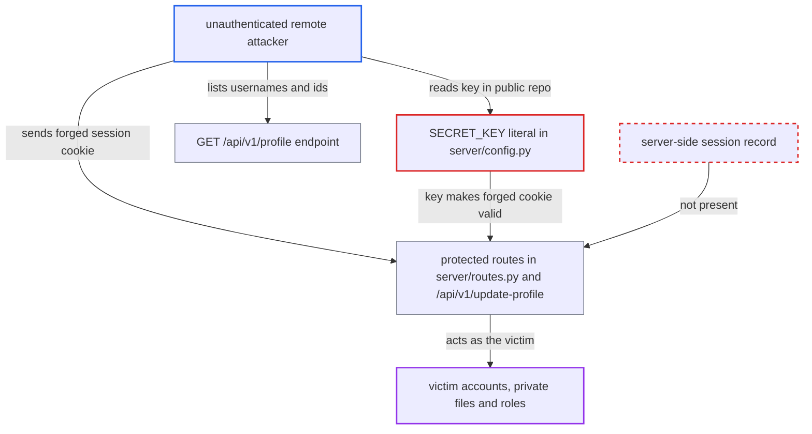

# Hard-coded Flask SECRET_KEY lets anyone forge session cookies for any account

| Field | Value |
|---|---|
| ID | `find_01CwCE6Ec9ha6AjrsuiX6sP4` |
| Severity | **Critical** |
| Status | open |
| CWE | CWE-321 — Hard-coded cryptographic key |
| Created | 2026-10-22T17:52:30.839197Z |
| Claude Security | https://claude.ai/security/findings/find_01CwCE6Ec9ha6AjrsuiX6sP4 |

## Description

Anyone on the network can log in as any existing user, admins included, without a password. They can read that user's private files and profile, change the account's details and role, and delete the user's files. The attack needs only the signing key, which is committed to the public repository. `SECRET_KEY` in `server/config.py` is a hard-coded literal that signs the session cookie.

1. **attacker** reads the signing key from the public repository. `SECRET_KEY` is a hard-coded 19-character literal in `server/config.py`, and it is the key Flask uses to sign the session cookie. ([`server/config.py:7`](https://github.com/cx-benchmark/threatbyte/blob/ede28f27e7e5061866a67b19b6088df4dd11c569/server/config.py#L7))
2. **the app setup in `server/__init__.py`** installs the literal as the Flask secret key. `app.config.from_object(Config)` runs in every run mode, and nothing in `run.py` or the `Dockerfile` overrides the key from the environment. ([`server/__init__.py:10`](https://github.com/cx-benchmark/threatbyte/blob/ede28f27e7e5061866a67b19b6088df4dd11c569/server/__init__.py#L10))
3. **attacker** lists usernames and ids through the unauthenticated `GET /api/v1/profile?user_id=N`. The endpoint returns the `username` and `role` for each sequential id, so the attacker learns which accounts exist, including an admin. ([`server/api/v1/api_v1.py:154-168`](https://github.com/cx-benchmark/threatbyte/blob/ede28f27e7e5061866a67b19b6088df4dd11c569/server/api/v1/api_v1.py#L154-L168))
4. **attacker** signs a session cookie naming the victim and sends it. The payload holds `username` and `user_id`. The cookie is named `session` under `flask run` and `session_token` under `python run.py`, and both carry the same forgeable signed payload. ([`run.py:8`](https://github.com/cx-benchmark/threatbyte/blob/ede28f27e7e5061866a67b19b6088df4dd11c569/run.py#L8))
5. **the routes in `server/routes.py`** accept the forged cookie as a full login. Each protected route only checks `'username' in session` and then uses `session['username']` (or `session['user_id']` for `/profile`) to pick the acting user. There is no server-side session record, so the per-file ownership checks run against the forged identity. ([`server/routes.py:121-145`](https://github.com/cx-benchmark/threatbyte/blob/ede28f27e7e5061866a67b19b6088df4dd11c569/server/routes.py#L121-L145))
6. **the handler for `/update_profile`** rewrites the victim's account from form fields. It trusts `session['username']` and sets `username`, `email`, `role`, `permissions` and the profile picture, which can lock the owner out. ([`server/routes.py:170-237`](https://github.com/cx-benchmark/threatbyte/blob/ede28f27e7e5061866a67b19b6088df4dd11c569/server/routes.py#L170-L237))
7. **the handler for `/api/v1/update-profile`** accepts the forged `user_id` as the caller. The ownership check compares against the forged id, and the admin check reads the role of that forged id. Forging an admin id therefore allows `role` and `permissions` writes. ([`server/api/v1/api_v1.py:183-207`](https://github.com/cx-benchmark/threatbyte/blob/ede28f27e7e5061866a67b19b6088df4dd11c569/server/api/v1/api_v1.py#L183-L207))

## Assessment

The attacker is unauthenticated and remote. They need no account and no victim action. They read the key from the public repository and look up usernames and ids with the open `GET /api/v1/profile?user_id=1..N`. Then they sign a cookie with Flask 2.2.5's session serializer (`itsdangerous`, salt `cookie-session`, HMAC-SHA1). The cookie works on every protected route in `server/routes.py` and on `/api/v1/update-profile`, under either cookie name. The targets are whatever accounts exist in a deployment. The seed accounts in `db/create_dummy_data.py` are not loaded by the `Dockerfile` or the README steps. The threat model lists forgeable sessions from a hard-coded `SECRET_KEY` as an intentional weakness that must still be reported.

Impact: The attacker acts as any existing account, admins included. They read every user's profile and private files, upload and overwrite files, rewrite any account's username, email, role and permissions, and delete any user's files. The service keeps running, and availability loss is limited to per-account lockout and file deletion. The same key also signs the API JWTs, but `token_required` is applied to no resource, so JWTs have no live effect today.

## Recommendation

The key that signs sessions and JWTs is a constant in source control (`server/config.py:7`). `server/__init__.py:10` loads it unconditionally, so the login boundary depends on a value every reader of the repository knows.

Fix criteria: The signing key is unique per deployment, high-entropy and absent from the repository. It is supplied at runtime from the environment or a secrets store. The app refuses to start when the key is missing or is a known default. A session cookie signed with the committed literal is rejected, under either cookie name (`session` or `session_token`), and the request is redirected to `/login` or answered 401. A JWT signed with the committed literal is also rejected. The repository contains no literal key.

## Evidence

**https://github.com/cx-benchmark/threatbyte**

- [`server/config.py:7`](https://github.com/cx-benchmark/threatbyte/blob/ede28f27e7e5061866a67b19b6088df4dd11c569/server/config.py#L7)
- [`server/__init__.py:10`](https://github.com/cx-benchmark/threatbyte/blob/ede28f27e7e5061866a67b19b6088df4dd11c569/server/__init__.py#L10)
- [`server/routes.py:121-145`](https://github.com/cx-benchmark/threatbyte/blob/ede28f27e7e5061866a67b19b6088df4dd11c569/server/routes.py#L121-L145)
- [`server/routes.py:170-237`](https://github.com/cx-benchmark/threatbyte/blob/ede28f27e7e5061866a67b19b6088df4dd11c569/server/routes.py#L170-L237)
- [`run.py:8`](https://github.com/cx-benchmark/threatbyte/blob/ede28f27e7e5061866a67b19b6088df4dd11c569/run.py#L8)
- [`server/api/v1/api_v1.py:183-207`](https://github.com/cx-benchmark/threatbyte/blob/ede28f27e7e5061866a67b19b6088df4dd11c569/server/api/v1/api_v1.py#L183-L207)
- [`server/api/v1/api_v1.py:154-168`](https://github.com/cx-benchmark/threatbyte/blob/ede28f27e7e5061866a67b19b6088df4dd11c569/server/api/v1/api_v1.py#L154-L168)
- [`server/api/v1/api_v1.py:94`](https://github.com/cx-benchmark/threatbyte/blob/ede28f27e7e5061866a67b19b6088df4dd11c569/server/api/v1/api_v1.py#L94)

