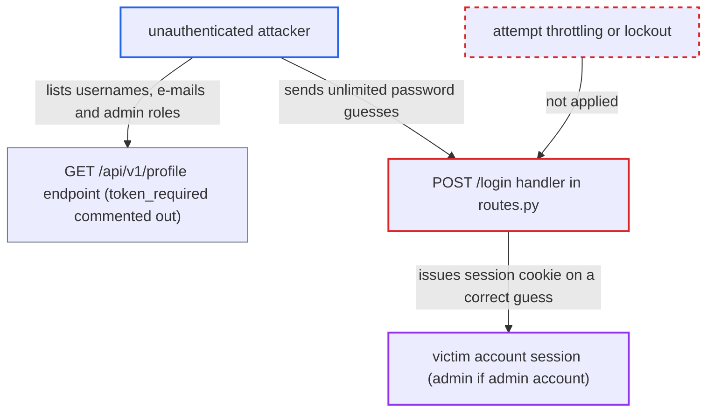

# Web /login has no brute-force protection, lockout or rate limiting

| Field | Value |
|---|---|
| ID | `find_01XrPAovxGPZcobDWECnKCHZ` |
| Severity | **Critical** |
| Status | open |
| CWE | CWE-307 — Brute force |
| Created | 2026-10-22T17:51:45.630899Z |
| Claude Security | https://claude.ai/security/findings/find_01XrPAovxGPZcobDWECnKCHZ |

## Description

An unauthenticated attacker on the network can guess passwords for any account on the web login without limit. A correct guess gives a full session as that user, and as an administrator if the account is an admin. The cause is `POST /login` in `server/routes.py`, which has no attempt counter, delay, lockout or CAPTCHA. Success also depends on the victim's password being within the attacker's guess budget.

1. **attacker** collects valid usernames and e-mails, and which accounts have the `admin` role. `GET /api/v1/profile?user_id=N` answers without credentials because its `@token_required` decorator is commented out. The attacker can also simply know or guess a username.
2. **attacker** scripts repeated `POST /login` requests with `username` and `password` form fields. The attacker sends one wordlist guess per request against a chosen account. ([`server/routes.py:36-61`](https://github.com/cx-benchmark/threatbyte/blob/ede28f27e7e5061866a67b19b6088df4dd11c569/server/routes.py#L36-L61))
3. **the login handler in `server/routes.py`** evaluates every attempt at full speed. It looks the account up by username or e-mail and compares `custom_hash(password)`. It keeps no failed-attempt state, and `server/__init__.py` registers no rate-limit extension or `before_request` hook to compensate. ([`server/routes.py:36-61`](https://github.com/cx-benchmark/threatbyte/blob/ede28f27e7e5061866a67b19b6088df4dd11c569/server/routes.py#L36-L61))
4. **the login handler in `server/routes.py`** answers a correct guess with a 302 redirect to `/dashboard` and a session cookie. A wrong guess re-renders the form, so the attacker can tell which guess worked. ([`server/routes.py:36-61`](https://github.com/cx-benchmark/threatbyte/blob/ede28f27e7e5061866a67b19b6088df4dd11c569/server/routes.py#L36-L61))
5. **attacker** uses the session cookie as the victim. The attacker now holds an authenticated session for that account.

## Assessment

The attacker is anyone who can reach `/login` over the network, with no account. They need a username or e-mail, which they can know, guess, or list through `GET /api/v1/profile?user_id=N`. Success depends on the victim's password being within the attacker's guess budget, which the attacker does not control. Signup in `server/routes.py` accepts any non-empty password, so weak passwords are allowed and guessing works better. The optional seed script `db/create_dummy_data.py` adds an `admin`-role account `dave_black` with the password `password`. The `Dockerfile` and the README setup do not run it, so that account exists only where an operator ran the script by hand. The API login handler in `api_v1.py` has the same gap. The report tracks it as a separate candidate.

Impact: A successful guess gives a fully authenticated session as the victim. The attacker can read and download all their files, read and modify their profile including the `role` and `permissions` attributes, and upload and delete files as them. Against an admin account this is administrative access. The flaw itself has no availability impact.

## Recommendation

(1) The login handler in `server/routes.py` accepts unlimited authentication attempts. It has no throttling, lockout or CAPTCHA.

Fix criteria: Repeated failed logins for an account and/or source are throttled by a progressive delay, a temporary lockout, or a CAPTCHA after a small number of failures. This applies to both web and API login, and failures are logged. A scripted run of about 50 wrong passwords against one account is rejected or slowed before it completes, even if a later guess would be correct.

(2) Signup in `server/routes.py` accepts any non-empty password, so guessable passwords enter the system and make online guessing effective.

Fix criteria: Signup enforces a minimum password length and rejects common or breached passwords. Signup refuses `password`, `123456` and single-character passwords.

## Evidence

**https://github.com/cx-benchmark/threatbyte**

- [`server/routes.py:36-61`](https://github.com/cx-benchmark/threatbyte/blob/ede28f27e7e5061866a67b19b6088df4dd11c569/server/routes.py#L36-L61)
- [`server/__init__.py:6-16`](https://github.com/cx-benchmark/threatbyte/blob/ede28f27e7e5061866a67b19b6088df4dd11c569/server/__init__.py#L6-L16)
- [`server/routes.py:84-93`](https://github.com/cx-benchmark/threatbyte/blob/ede28f27e7e5061866a67b19b6088df4dd11c569/server/routes.py#L84-L93)
- [`db/create_dummy_data.py:19-28`](https://github.com/cx-benchmark/threatbyte/blob/ede28f27e7e5061866a67b19b6088df4dd11c569/db/create_dummy_data.py#L19-L28)

