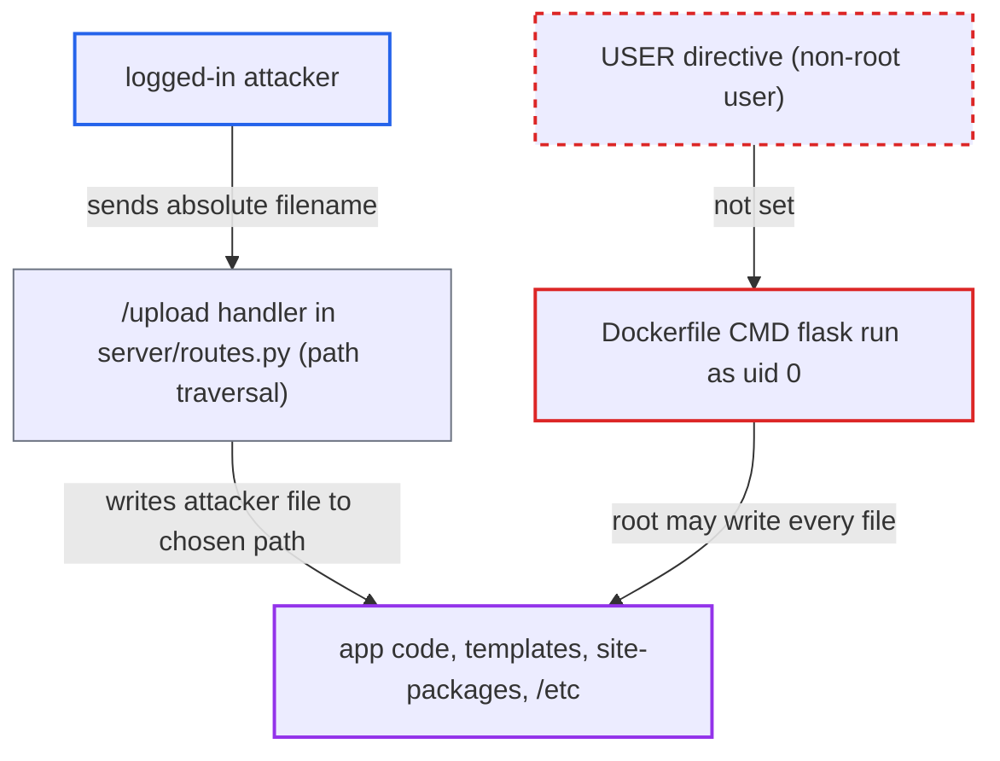

# Docker image runs Flask as root, so /upload traversal can overwrite application code

| Field | Value |
|---|---|
| ID | `find_01S1TEGdDCtmDMohiHgGD4b7` |
| Severity | **High** |
| Status | open |
| CWE | CWE-250 — Execution with unnecessary privileges |
| Created | 2026-10-22T17:55:37.049449Z |
| Claude Security | https://claude.ai/security/findings/find_01S1TEGdDCtmDMohiHgGD4b7 |

## Description

A logged-in user of the app can overwrite application code, templates and Python libraries inside the container, which leads to code execution as root in that container. It needs only an account from the open `/signup` and the separate `/upload` path-traversal bug. The `Dockerfile` has no `USER` directive, so `flask run` runs as uid 0 and can write every file in the image.

1. **attacker** registers through `/signup` and logs in. Signup is open to any internet user, so the only precondition is a normal account.
2. **attacker** sends `POST /upload` with a multipart filename that is an absolute path. An example is `/app/client/templates/profile.html` containing a Jinja payload, or `/usr/local/lib/python3.13/site-packages/x.pth`. ([`server/routes.py:262-264`](https://github.com/cx-benchmark/threatbyte/blob/ede28f27e7e5061866a67b19b6088df4dd11c569/server/routes.py#L262-L264))
3. **the upload code in `server/routes.py`** joins the filename to `UPLOAD_FOLDER` and saves the file there. `os.path.join` lets an absolute filename replace `UPLOAD_FOLDER`, and `../` also escapes it, so `file.save(filepath)` writes to the attacker's chosen path. ([`server/routes.py:262-264`](https://github.com/cx-benchmark/threatbyte/blob/ede28f27e7e5061866a67b19b6088df4dd11c569/server/routes.py#L262-L264))
4. **the Flask process** completes the write to a root-owned file. The `Dockerfile` has no `USER` instruction and `CMD ["flask", "run"]` therefore runs as uid 0, so nothing blocks writes to the app tree, `site-packages` or `/etc`. ([`Dockerfile:1-19`](https://github.com/cx-benchmark/threatbyte/blob/ede28f27e7e5061866a67b19b6088df4dd11c569/Dockerfile#L1-L19))
5. **Jinja or the Python interpreter** runs the attacker's content. A template not yet rendered since start is compiled from disk on its first render, for example on a request to `/profile`. An overwritten `.py` file or a `.pth` file runs at the next restart. ([`server/__init__.py:7`](https://github.com/cx-benchmark/threatbyte/blob/ede28f27e7e5061866a67b19b6088df4dd11c569/server/__init__.py#L7))

## Assessment

Any internet user can register through the open `/signup` and log in. They then send `POST /upload` with a crafted multipart filename. The write succeeds on root-owned files only because the container runs as root. A Jinja payload runs on the first render of a template not yet compiled since start. Overwriting `server/routes.py` or adding a `.pth` file in `site-packages` runs at the next restart. Under the Docker start path `FLASK_DEBUG` is unset, so there is no reloader and templates do not auto-reload. No victim action is needed.

Impact: The attacker gets code execution as root inside the container. From there they can read the SQLite database, all uploads and the secret key, change application code and data, and destroy the app or its runtime. The shipped `docker run -p 5000:5000` mounts nothing from the host, so the impact stays inside the container.

## Recommendation

The image never drops privileges: the `Dockerfile` has no `USER` directive, so the web process runs as root. Any file write in the app can then reach the application code, templates, Python runtime and system directories.

Fix criteria: The application process runs as a dedicated non-root user that can write only `db/` and `server/uploads`. The application code, templates, `site-packages` and system directories are read-only to it. Running `id` inside the running container shows a non-zero uid. An upload whose filename is `/app/client/templates/x.html` or `/etc/x` fails with a permission error and creates nothing.

## Evidence

**https://github.com/cx-benchmark/threatbyte**

- [`Dockerfile:1-19`](https://github.com/cx-benchmark/threatbyte/blob/ede28f27e7e5061866a67b19b6088df4dd11c569/Dockerfile#L1-L19)
- [`server/routes.py:262-264`](https://github.com/cx-benchmark/threatbyte/blob/ede28f27e7e5061866a67b19b6088df4dd11c569/server/routes.py#L262-L264)
- [`server/__init__.py:7`](https://github.com/cx-benchmark/threatbyte/blob/ede28f27e7e5061866a67b19b6088df4dd11c569/server/__init__.py#L7)
- [`server/config.py:8-9`](https://github.com/cx-benchmark/threatbyte/blob/ede28f27e7e5061866a67b19b6088df4dd11c569/server/config.py#L8-L9)

