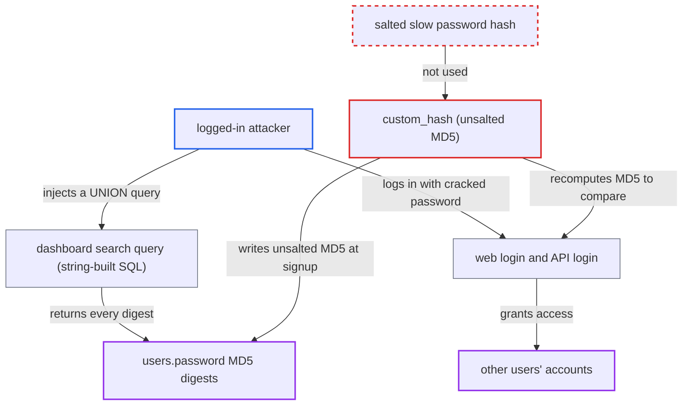

# Passwords stored and verified as unsalted, fast MD5 digests

| Field | Value |
|---|---|
| ID | `find_01KmeAZmvTwtzcYMgFCLVCUU` |
| Severity | **High** |
| Status | open |
| CWE | CWE-916 — Weak password hashing |
| Created | 2026-10-22T17:51:45.696348Z |
| Claude Security | https://claude.ai/security/findings/find_01KmeAZmvTwtzcYMgFCLVCUU |

## Description

A logged-in user can recover other users' plaintext passwords and then log in as them, including any `admin`-role account. Passwords are stored as single-round, unsalted MD5 digests, so they crack quickly offline. The attacker needs the digests first, and the report says the dashboard search injection provides them. The weak hash is `custom_hash` in `server/routes.py`.

1. **attacker** self-registers through `/signup` and logs in. Signup stores `custom_hash(password)` in `users.password`, so every stored credential is a raw MD5 of the plaintext and identical passwords give identical values. ([`server/routes.py:92-99`](https://github.com/cx-benchmark/threatbyte/blob/ede28f27e7e5061866a67b19b6088df4dd11c569/server/routes.py#L92-L99))
2. **attacker** requests `GET /dashboard?search=' UNION SELECT username||':'||password FROM users--`. The dashboard search builds its SQL with an f-string and renders the result rows back to the user, so every user's MD5 digest is displayed. ([`server/routes.py:136-143`](https://github.com/cx-benchmark/threatbyte/blob/ede28f27e7e5061866a67b19b6088df4dd11c569/server/routes.py#L136-L143))
3. **attacker** cracks the digests offline with wordlists or rainbow tables. `custom_hash` is one unsalted MD5 round with no work factor, so one precomputed table or cracking run covers every account. ([`server/routes.py:392-403`](https://github.com/cx-benchmark/threatbyte/blob/ede28f27e7e5061866a67b19b6088df4dd11c569/server/routes.py#L392-L403))
4. **attacker** sends the recovered password to `POST /login` or `/api/v1/login`. The web login compares `user['password'] == custom_hash(password)`, so a password that hashes to the stored digest is accepted. ([`server/routes.py:50`](https://github.com/cx-benchmark/threatbyte/blob/ede28f27e7e5061866a67b19b6088df4dd11c569/server/routes.py#L50))
5. **the API login in `api_v1.py`** issues a 24-hour JWT on success. It uses the same `custom_hash` comparison, so the weak scheme covers every authentication path. ([`server/api/v1/api_v1.py:127`](https://github.com/cx-benchmark/threatbyte/blob/ede28f27e7e5061866a67b19b6088df4dd11c569/server/api/v1/api_v1.py#L127))

## Assessment

The attacker registers a normal account through `/signup` and logs in. The digests must first be disclosed through a separate flaw, so the attack depends on one. In the shipped application that flaw is the string-built dashboard search query at `routes.py:137`, which any authenticated user can reach. With the digests, the attacker cracks them offline and logs in through either `POST /login` or `/api/v1/login`. Anyone else who obtains the `users` table by any other means can do the same.

Impact: The attacker recovers the plaintext password of every user whose password is in common wordlists. They can log in as those users, including any `admin`-role account, and read, overwrite or delete those users' files and profile. Recovered passwords also expose password reuse. Availability is not affected.

## Recommendation

`custom_hash` in `routes.py` hashes passwords with one round of unsalted MD5. Once the digests are disclosed, they give no resistance to offline guessing or precomputed tables.

Fix criteria: Passwords are stored with a vetted, salted, deliberately slow scheme (argon2id, scrypt or bcrypt) with a unique salt per user. Signup, web login and API login all use it. Existing MD5 records are rehashed at next login or forced to reset. Two accounts with the same password store different values. A stored value is no longer `md5(plaintext)`. Each offline guess costs on the order of tens of milliseconds.

## Evidence

**https://github.com/cx-benchmark/threatbyte**

- [`server/routes.py:392-403`](https://github.com/cx-benchmark/threatbyte/blob/ede28f27e7e5061866a67b19b6088df4dd11c569/server/routes.py#L392-L403)
- [`server/routes.py:92-99`](https://github.com/cx-benchmark/threatbyte/blob/ede28f27e7e5061866a67b19b6088df4dd11c569/server/routes.py#L92-L99)
- [`server/routes.py:50`](https://github.com/cx-benchmark/threatbyte/blob/ede28f27e7e5061866a67b19b6088df4dd11c569/server/routes.py#L50)
- [`server/api/v1/api_v1.py:127`](https://github.com/cx-benchmark/threatbyte/blob/ede28f27e7e5061866a67b19b6088df4dd11c569/server/api/v1/api_v1.py#L127)
- [`server/routes.py:136-143`](https://github.com/cx-benchmark/threatbyte/blob/ede28f27e7e5061866a67b19b6088df4dd11c569/server/routes.py#L136-L143)

