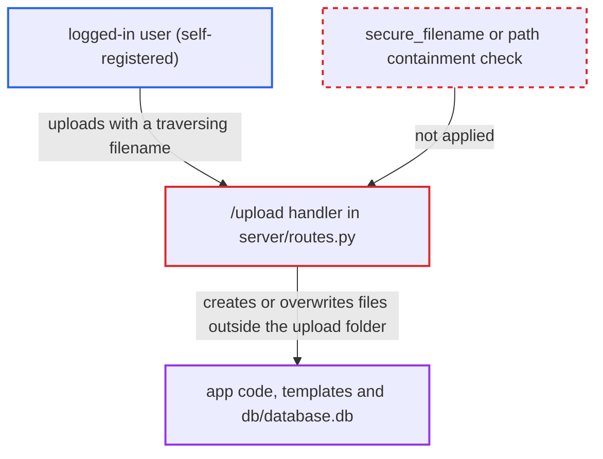

# Path traversal in /upload filename allows arbitrary file write and RCE

| Field | Value |
|---|---|
| ID | `find_01NjBBwUZZ1jDZR3FGtvKqRW` |
| Severity | **High** |
| Status | open |
| CWE | CWE-22 — Path traversal |
| Created | 2026-10-22T17:54:18.940498Z |
| Claude Security | https://claude.ai/security/findings/find_01NjBBwUZZ1jDZR3FGtvKqRW |

## Description

Any logged-in user can create or overwrite any file the service account can write, which leads to code execution on the server. The service account is root in the shipped Dockerfile. Anyone can get an account through the open `/signup`. The cause is the `/upload` handler in `server/routes.py`, which saves the file under the client-supplied filename without `secure_filename()` or any check for separators.

1. **attacker** registers through `/signup` and logs in. The only gate on `/upload` is `'username' in session`, and `/signup` is open to anyone. ([`server/routes.py:250-251`](https://github.com/cx-benchmark/threatbyte/blob/ede28f27e7e5061866a67b19b6088df4dd11c569/server/routes.py#L250-L251))
2. **attacker** sends `POST /upload` as multipart with a traversing filename. The `Content-Disposition` filename can be something like `../../client/templates/edit_profile.html`, `../../db/database.db` or `../routes.py`, or an absolute path. Werkzeug passes it to `file.filename` unchanged. ([`server/routes.py:262-264`](https://github.com/cx-benchmark/threatbyte/blob/ede28f27e7e5061866a67b19b6088df4dd11c569/server/routes.py#L262-L264))
3. **the `/upload` handler** joins the client filename onto `UPLOAD_FOLDER` and saves the file there. `os.path.join` keeps `../` segments and drops the base directory for an absolute name, and `file.save()` opens the result with mode `wb`, which creates or truncates the file. The write runs before the user lookup. ([`server/routes.py:262-264`](https://github.com/cx-benchmark/threatbyte/blob/ede28f27e7e5061866a67b19b6088df4dd11c569/server/routes.py#L262-L264))
4. **attacker** targets files that sit one or two directories above the upload folder. The upload folder is `server/uploads` inside the package, so `routes.py`, `config.py`, the templates and `db/database.db` are all within reach. ([`server/config.py:9`](https://github.com/cx-benchmark/threatbyte/blob/ede28f27e7e5061866a67b19b6088df4dd11c569/server/config.py#L9))
5. **the application** runs or loads the overwritten file. An overwritten template runs its Jinja payload when it is next rendered. An overwritten `db/database.db` takes effect on the next request. An overwritten `.py` file runs on reload or restart. ([`server/__init__.py:7`](https://github.com/cx-benchmark/threatbyte/blob/ede28f27e7e5061866a67b19b6088df4dd11c569/server/__init__.py#L7))

## Assessment

The attacker is anyone on the internet who signs up through the open `/signup` and logs in. Alternatively, the attacker can forge a session cookie with the hard-coded `SECRET_KEY`. The save at line 264 runs before the user lookup, so the forged cookie works even for a username that does not exist. No victim action is needed. Timing depends on the deployment. Under `python run.py` (`debug=True`), templates auto-reload and the Werkzeug reloader restarts the app when `routes.py` changes, so code runs at once. Under the Docker `flask run` deployment, `app.debug` is False. A template overwrite then runs the first time it is rendered after start, and an overwritten `.py` file runs on the next restart. Overwriting `db/database.db` takes effect on the next request in every deployment, because `get_db_connection` reopens it each time. The traversing name is also stored in `files`. The read and delete routes use a URL converter that excludes `/` and serve through `send_from_directory`/`safe_join`, so only the write side is exploitable.

Impact: The attacker can create or overwrite any file the service account can write. That covers application code, templates and the application database. This gives code execution on the host, and with it every password hash, every user's files and the secret key. The attacker can also tamper with or destroy all data and the application, or stop the service.

## Recommendation

The upload path is built from the client-controlled filename in `server/routes.py` (lines 262-263) with no sanitising, so the write escapes `UPLOAD_FOLDER`.

Fix criteria: The stored path always resolves to a regular file directly inside the configured upload directory, whatever filename is supplied. Path separators, `..` segments and absolute paths are rejected or neutralised, for example with a server-generated name, or `secure_filename` plus a realpath containment check. A multipart upload with `filename="../../client/templates/x.html"`, or with an absolute path, is refused and creates nothing outside `server/uploads`.

## Evidence

**https://github.com/cx-benchmark/threatbyte**

- [`server/routes.py:262-264`](https://github.com/cx-benchmark/threatbyte/blob/ede28f27e7e5061866a67b19b6088df4dd11c569/server/routes.py#L262-L264)
- [`server/routes.py:250-251`](https://github.com/cx-benchmark/threatbyte/blob/ede28f27e7e5061866a67b19b6088df4dd11c569/server/routes.py#L250-L251)
- [`server/config.py:9`](https://github.com/cx-benchmark/threatbyte/blob/ede28f27e7e5061866a67b19b6088df4dd11c569/server/config.py#L9)
- [`server/__init__.py:7`](https://github.com/cx-benchmark/threatbyte/blob/ede28f27e7e5061866a67b19b6088df4dd11c569/server/__init__.py#L7)
- [`db/initialize_db.py:3-7`](https://github.com/cx-benchmark/threatbyte/blob/ede28f27e7e5061866a67b19b6088df4dd11c569/db/initialize_db.py#L3-L7)
- [`run.py:7-10`](https://github.com/cx-benchmark/threatbyte/blob/ede28f27e7e5061866a67b19b6088df4dd11c569/run.py#L7-L10)
- [`Dockerfile:10-19`](https://github.com/cx-benchmark/threatbyte/blob/ede28f27e7e5061866a67b19b6088df4dd11c569/Dockerfile#L10-L19)

