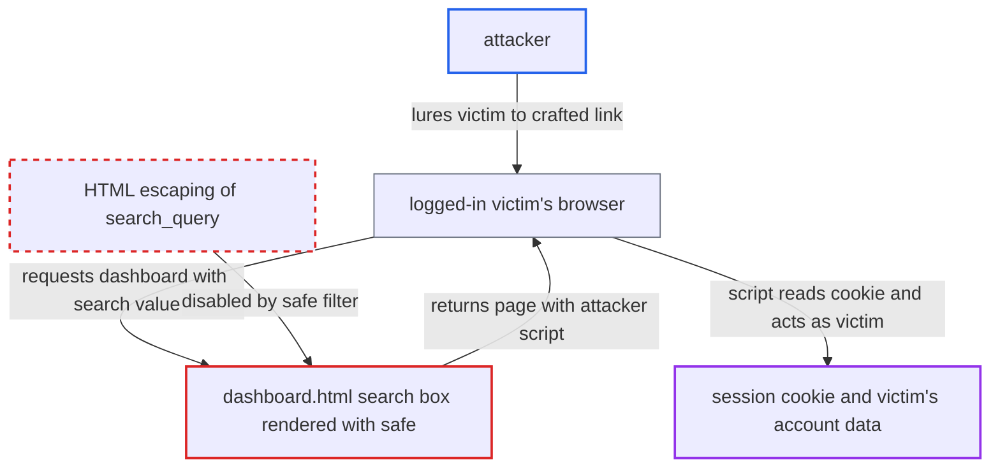

# Reflected XSS: dashboard search query rendered with |safe into an input attribute

| Field | Value |
|---|---|
| ID | `find_01WE4EYjNG3Sn5a5uK7ceVHf` |
| Severity | **High** |
| Status | open |
| CWE | CWE-79 — Cross-site scripting |
| Created | 2026-10-22T17:51:45.567541Z |
| Claude Security | https://claude.ai/security/findings/find_01WE4EYjNG3Sn5a5uK7ceVHf |

## Description

Anyone can run script in a logged-in victim's browser on the app's own site, and so take over the victim's account. The victim only has to open a crafted `/dashboard?search=...` link. The cause is `dashboard.html`, which prints the `search` value with `|safe`, so Jinja2 autoescaping is switched off for it.

1. **attacker** builds a link to `/dashboard` with a `search` value that closes the attribute. A value such as `">` ends the `value` attribute and adds a new element. It must contain no single quote, because the same string is later used in a SQL query.
2. **victim** opens the link while logged in, by clicking it or by being sent there from an attacker page. The session cookie is sent with this top-level GET request, because no `SameSite` is configured.
3. **the handler `dashboard()`** reads `search` from the query string and passes it unchanged to `dashboard.html`. The value is not encoded or validated on the way to the template. ([`server/routes.py:126`](https://github.com/cx-benchmark/threatbyte/blob/ede28f27e7e5061866a67b19b6088df4dd11c569/server/routes.py#L126))
4. **the template `dashboard.html`** writes the value into the search box with `|safe`. `|safe` marks the value as trusted, so `"`, `<` and `>` reach the response as they are and the attacker's markup becomes part of the page. ([`client/templates/dashboard.html:64`](https://github.com/cx-benchmark/threatbyte/blob/ede28f27e7e5061866a67b19b6088df4dd11c569/client/templates/dashboard.html#L64))
5. **attacker's script** runs in the app's origin and reads `document.cookie`. `SESSION_COOKIE_HTTPONLY = False` lets script read the signed session cookie, which is the only authentication for every web route. ([`server/config.py:6`](https://github.com/cx-benchmark/threatbyte/blob/ede28f27e7e5061866a67b19b6088df4dd11c569/server/config.py#L6))

## Assessment

The attacker needs no account. A logged-in victim must open a crafted `/dashboard?search=...` link. This can be a link the victim clicks, or an attacker page that sends the victim's browser there. The session check at `routes.py:124` passes for the victim, and the page is then rendered with the unescaped value. The payload cannot contain an unbalanced single quote, because the string is first concatenated into a SQL `LIKE` clause at `routes.py:137` and the query would fail before rendering. This is a limit on the payload, not a protection. The app sets no Content-Security-Policy and has no `after_request` output filtering. Under the Dockerfile's `flask run` the cookie is named `session`. It is named `session_token` only when `run.py` is run directly.

Impact: The script acts as the victim. It can steal the session cookie and replay it, or send same-origin requests directly. It can read the victim's profile and files, download files, and change the profile, role and permissions through `/update_profile`. It can also delete files through `POST /delete/<filename>`. This gives full control of the victim's account data, and deleting files has a limited effect on availability.

## Recommendation

`dashboard.html:64` applies `|safe` to `search_query`, which comes straight from the request query string. This turns untrusted input into trusted markup inside an HTML attribute.

Fix criteria: The search value is HTML-escaped for the attribute context when rendered, so autoescaping applies and `|safe` is not used on request-derived data. Requesting `/dashboard?search=%22%3E%3Cimg%20src%3Dx%20onerror%3Dalert(1)%3E` returns a response that contains `&#34;&gt;&lt;img ...` inside the attribute. No new element is created.

## Evidence

**https://github.com/cx-benchmark/threatbyte**

- [`client/templates/dashboard.html:64`](https://github.com/cx-benchmark/threatbyte/blob/ede28f27e7e5061866a67b19b6088df4dd11c569/client/templates/dashboard.html#L64)
- [`server/routes.py:126`](https://github.com/cx-benchmark/threatbyte/blob/ede28f27e7e5061866a67b19b6088df4dd11c569/server/routes.py#L126)
- [`server/routes.py:143`](https://github.com/cx-benchmark/threatbyte/blob/ede28f27e7e5061866a67b19b6088df4dd11c569/server/routes.py#L143)
- [`server/routes.py:136-138`](https://github.com/cx-benchmark/threatbyte/blob/ede28f27e7e5061866a67b19b6088df4dd11c569/server/routes.py#L136-L138)
- [`server/config.py:6`](https://github.com/cx-benchmark/threatbyte/blob/ede28f27e7e5061866a67b19b6088df4dd11c569/server/config.py#L6)

