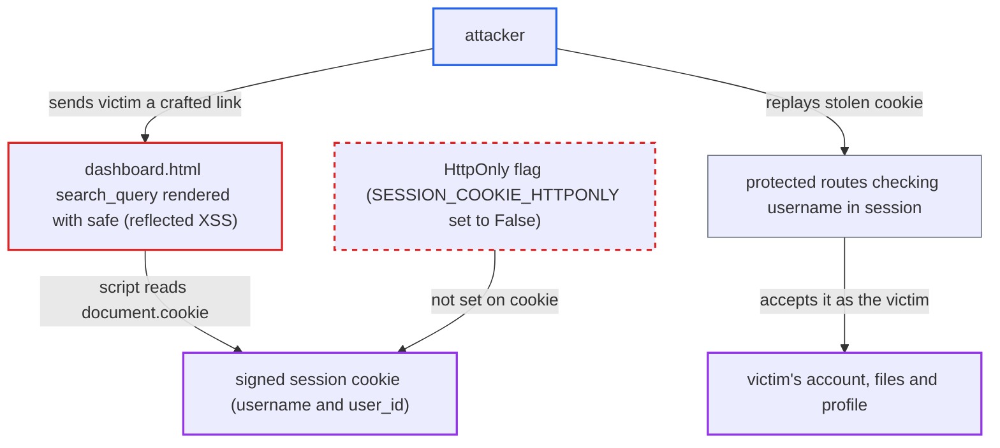

# Session cookie served without HttpOnly, so page XSS exfiltrates the login session

| Field | Value |
|---|---|
| ID | `find_01K5Loq8q5F9LUPT1y3qRqjm` |
| Severity | **High** |
| Status | open |
| CWE | CWE-1004 — Sensitive cookie without HttpOnly |
| Created | 2026-10-22T17:53:18.504812Z |
| Claude Security | https://claude.ai/security/findings/find_01K5Loq8q5F9LUPT1y3qRqjm |

## Description

An unauthenticated attacker can steal a logged-in user's session cookie and replay it to take over that account, including an admin's. It needs a logged-in victim to open a crafted `/dashboard` link. The cookie is readable by page scripts because `SESSION_COOKIE_HTTPONLY = False` is set in `server/config.py`.

1. **attacker** builds a `/dashboard` link with a script in the `search` parameter. The payload avoids a single quote, because `routes.py:137` puts the value into SQL first and a `'` would make the page fail. ([`server/routes.py:126-143`](https://github.com/cx-benchmark/threatbyte/blob/ede28f27e7e5061866a67b19b6088df4dd11c569/server/routes.py#L126-L143))
2. **logged-in victim** opens the link, or an attacker page that navigates to it. The `/dashboard` route passes `request.args.get('search')` straight to the template for any logged-in user. ([`server/routes.py:126-143`](https://github.com/cx-benchmark/threatbyte/blob/ede28f27e7e5061866a67b19b6088df4dd11c569/server/routes.py#L126-L143))
3. **template `dashboard.html`** prints the `search` value unescaped into the page. The line `value="{{ search_query | safe }}"` disables escaping, so the attacker's script runs in the app's own origin. ([`client/templates/dashboard.html:64`](https://github.com/cx-benchmark/threatbyte/blob/ede28f27e7e5061866a67b19b6088df4dd11c569/client/templates/dashboard.html#L64))
4. **injected script** reads the session cookie through `document.cookie` and sends it to an off-site host. `SESSION_COOKIE_HTTPONLY = False` is applied by `app.config.from_object(Config)`, so the `Set-Cookie` header has no `HttpOnly` attribute. ([`server/config.py:6`](https://github.com/cx-benchmark/threatbyte/blob/ede28f27e7e5061866a67b19b6088df4dd11c569/server/config.py#L6))
5. **attacker** replays the stolen cookie from anywhere. Protected routes only check `'username' in session`, with no binding to IP, user agent or a server-side session store. ([`server/routes.py:124`](https://github.com/cx-benchmark/threatbyte/blob/ede28f27e7e5061866a67b19b6088df4dd11c569/server/routes.py#L124))

## Assessment

The attacker needs no account. A logged-in victim must open a link or an attacker page that navigates to `/dashboard` with the payload in `search`. That reflected XSS in `client/templates/dashboard.html` is the delivery route the report confirms. The report says the app has other script-injection sinks in its own origin, and any of them would work the same way. Sessions are client-side, so `/logout` (`session.clear()`) only overwrites the victim's own cookie. The stolen copy stays valid until its signature is older than `PERMANENT_SESSION_LIFETIME`, which is 31 days by default.

Impact: With the replayed cookie the attacker acts as the victim in the web app. They can read the profile and files (`/uploads/<filename>`, `/download/<filename>`), and upload and delete files. They can also change username, email, role and permissions through `/update_profile`. If the victim is an admin, the attacker gets that account's privileges. The only availability impact the report names is deleting the victim's files.

## Recommendation

`SESSION_COOKIE_HTTPONLY = False` in `server/config.py` (re-applied in `run.py`) lets any script in the app's origin read the authentication cookie. One XSS therefore yields a session that can be replayed elsewhere.

Fix criteria: The session cookie is issued with `HttpOnly` in every start mode, both `flask run` and `python run.py`. The login response's `Set-Cookie` header includes `HttpOnly`. `document.cookie` on a logged-in page does not contain the session cookie, so the dashboard XSS payload sends no session value. Extra hardening is `SameSite=Lax`, `Secure` under TLS, and revoking sessions on logout on the server. The report lists these as additional measures, not part of this fix.

## Evidence

**https://github.com/cx-benchmark/threatbyte**

- [`server/config.py:6`](https://github.com/cx-benchmark/threatbyte/blob/ede28f27e7e5061866a67b19b6088df4dd11c569/server/config.py#L6)
- [`server/__init__.py:10`](https://github.com/cx-benchmark/threatbyte/blob/ede28f27e7e5061866a67b19b6088df4dd11c569/server/__init__.py#L10)
- [`client/templates/dashboard.html:64`](https://github.com/cx-benchmark/threatbyte/blob/ede28f27e7e5061866a67b19b6088df4dd11c569/client/templates/dashboard.html#L64)
- [`server/routes.py:126-143`](https://github.com/cx-benchmark/threatbyte/blob/ede28f27e7e5061866a67b19b6088df4dd11c569/server/routes.py#L126-L143)
- [`server/routes.py:124`](https://github.com/cx-benchmark/threatbyte/blob/ede28f27e7e5061866a67b19b6088df4dd11c569/server/routes.py#L124)

