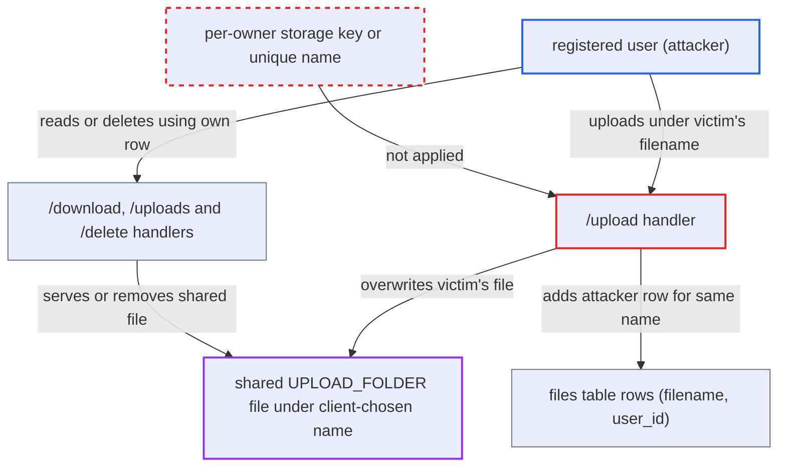

# Shared upload namespace lets any user overwrite, delete or read other users' files

| Field | Value |
|---|---|
| ID | `find_01HJp9nSdcyZa6Lo7hrSdCxm` |
| Severity | **High** |
| Status | open |
| CWE | CWE-639 — Broken object level authorization |
| Created | 2026-10-22T17:52:30.480502Z |
| Claude Security | https://claude.ai/security/findings/find_01HJp9nSdcyZa6Lo7hrSdCxm |

## Description

Any registered user can overwrite or delete another user's uploaded file. They can also read files that a victim later uploads under a name the attacker has already claimed. Existing content cannot be read without first overwriting it. The cause is that `/upload` stores every file in one shared folder under the client-chosen name, and the `files` table has no uniqueness on `filename`.

1. **attacker (registered user)** learns the filename of a victim's file. The report says the name can be guessed or listed through the dashboard search SQL injection, which is filed separately. ([`server/routes.py:137-138`](https://github.com/cx-benchmark/threatbyte/blob/ede28f27e7e5061866a67b19b6088df4dd11c569/server/routes.py#L137-L138))
2. **attacker** posts a file to `/upload` under the victim's filename. The route writes to `UPLOAD_FOLDER/<filename>` with `file.save()`, which truncates the existing file and has no check for an existing file or another owner. ([`server/routes.py:262-264`](https://github.com/cx-benchmark/threatbyte/blob/ede28f27e7e5061866a67b19b6088df4dd11c569/server/routes.py#L262-L264))
3. **the `/upload` handler** inserts a `(filename, user_id)` row for the attacker. The insert is unconditional, and the `files` schema has no UNIQUE constraint on `filename`, so the attacker now holds a row for the same physical file. ([`server/routes.py:275`](https://github.com/cx-benchmark/threatbyte/blob/ede28f27e7e5061866a67b19b6088df4dd11c569/server/routes.py#L275))
4. **attacker** optionally calls `POST /delete/<filename>`. The handler checks only `filename AND user_id`, removes the shared file with `os.remove`, and deletes only the attacker's row. The victim's row is left pointing at nothing. ([`server/routes.py:355-366`](https://github.com/cx-benchmark/threatbyte/blob/ede28f27e7e5061866a67b19b6088df4dd11c569/server/routes.py#L355-L366))
5. **attacker** optionally claims a name first and later calls `GET /download/<name>`. The route serves the one shared file to any holder of a row for that name. It therefore returns whatever the victim uploads under that name afterwards. ([`server/routes.py:329-334`](https://github.com/cx-benchmark/threatbyte/blob/ede28f27e7e5061866a67b19b6088df4dd11c569/server/routes.py#L329-L334))

## Assessment

The attacker is any registered user, since `/signup` is open and the other routes need only a logged-in account. They need a victim's filename, which they can guess or list through the dashboard search SQL injection at `server/routes.py:137`. No action by the victim is needed to overwrite or delete the file. Reading works only the other way round: the attacker claims a name first, and the victim later uploads under it. Two users uploading the same name, for example `report.pdf`, share one file. A name with no path separators is enough, and `secure_filename()` would not remove the collision. This is separate from `../` path traversal.

Impact: The attacker can replace or destroy the content of any other user's uploaded file whose name they know. The victim then downloads the attacker's content or sees 'File not found on server'. Reading is limited to files uploaded under a name the attacker already holds. The service stays up.

## Recommendation

All users' files share one directory and one client-chosen name space (`server/routes.py:262-264`, `275`). The `(filename, user_id)` check therefore does not match one distinct object per user, and a name collision aliases one user's file onto another's.

Fix criteria: Each stored object is bound to its owner independently of the client-supplied name, for example by a per-user directory or a server-generated storage key held in the `files` row. The original name is kept only as display metadata. `/uploads`, `/download` and `/delete` all resolve the file through that owner-bound reference. Test: user B uploads a file with the same name as user A's file. A's file is not changed, not exposed and cannot be deleted by B.

## Evidence

**https://github.com/cx-benchmark/threatbyte**

- [`server/routes.py:262-264`](https://github.com/cx-benchmark/threatbyte/blob/ede28f27e7e5061866a67b19b6088df4dd11c569/server/routes.py#L262-L264)
- [`server/routes.py:275`](https://github.com/cx-benchmark/threatbyte/blob/ede28f27e7e5061866a67b19b6088df4dd11c569/server/routes.py#L275)
- [`db/create_db_tables.py:29-36`](https://github.com/cx-benchmark/threatbyte/blob/ede28f27e7e5061866a67b19b6088df4dd11c569/db/create_db_tables.py#L29-L36)
- [`server/routes.py:355-366`](https://github.com/cx-benchmark/threatbyte/blob/ede28f27e7e5061866a67b19b6088df4dd11c569/server/routes.py#L355-L366)
- [`server/routes.py:329-334`](https://github.com/cx-benchmark/threatbyte/blob/ede28f27e7e5061866a67b19b6088df4dd11c569/server/routes.py#L329-L334)
- [`server/routes.py:297-302`](https://github.com/cx-benchmark/threatbyte/blob/ede28f27e7e5061866a67b19b6088df4dd11c569/server/routes.py#L297-L302)
- [`server/routes.py:137-138`](https://github.com/cx-benchmark/threatbyte/blob/ede28f27e7e5061866a67b19b6088df4dd11c569/server/routes.py#L137-L138)

