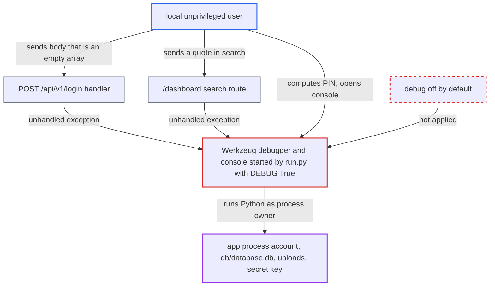

# Shipped DEBUG=True runs Werkzeug debugger and reloader under run.py

| Field | Value |
|---|---|
| ID | `find_01ESYTta4ePSyTXgyVwo52ez` |
| Severity | **High** |
| Status | open |
| CWE | CWE-489 — Active debug code |
| Created | 2026-10-22T17:55:37.130388Z |
| Claude Security | https://claude.ai/security/findings/find_01ESYTta4ePSyTXgyVwo52ez |

## Description

Another local user on a host where the app was started with `python run.py` can run arbitrary Python as the account that started it. A remote party with no local access gets nothing from this flaw. The cause is `DEBUG = True` in `server/config.py`, which `run.py` passes to `app.run()`. That turns on the Werkzeug debugger and reloader, and the console's PIN can be worked out from values a local user can read.

1. **the shipped config in `server/config.py`** sets `DEBUG = True` with no environment override. `server/__init__.py` copies it into `app.config`, which also enables `PROPAGATE_EXCEPTIONS` and Jinja template auto-reload. ([`server/config.py:5`](https://github.com/cx-benchmark/threatbyte/blob/ede28f27e7e5061866a67b19b6088df4dd11c569/server/config.py#L5))
2. **the start script `run.py`** passes the flag to `app.run(debug=...)` with no host. Flask then turns on the debugger and reloader and binds `127.0.0.1:5000`. Werkzeug adds that host to `trusted_hosts`. This is the documented `python run.py` mode. ([`run.py:7-10`](https://github.com/cx-benchmark/threatbyte/blob/ede28f27e7e5061866a67b19b6088df4dd11c569/run.py#L7-L10))
3. **a local unprivileged user** triggers an unhandled exception. `POST /api/v1/login` with JSON body `[]` makes `data.get` raise `AttributeError`, with no login needed. A quote in `/dashboard?search=` from any self-registered account is a second trigger. ([`server/api/v1/api_v1.py:114-116`](https://github.com/cx-benchmark/threatbyte/blob/ede28f27e7e5061866a67b19b6088df4dd11c569/server/api/v1/api_v1.py#L114-L116))
4. **the Werkzeug debugger** returns its interactive traceback page instead of a generic 500. The page shows the exception text, absolute file paths, the source lines of every frame and the debugger secret.
5. **a local unprivileged user** computes the console PIN and sends it with `Host: 127.0.0.1`. The PIN comes from the process owner's username, the `flask/app.py` path shown in the traceback, the MAC address, `/etc/machine-id` and `/proc/<pid>/cgroup`. Another local user can read all of these. The console is gated only by this PIN.
6. **a local unprivileged user** runs Python commands in the console. The commands run inside the app process, as the account that started the app.

## Assessment

The attacker is an unprivileged user on the same host where the app was started with `python run.py`. That is the README's start command and is also used by CI's ZAP job. The server listens on `127.0.0.1:5000` only. The attacker needs no victim action. Either of two triggers works: `POST /api/v1/login` with body `[]`, which needs no login, or a quote in `/dashboard?search=` from a self-registered account. The attacker then derives the debugger PIN from host values and uses the console with `Host: 127.0.0.1`. The reloader also makes the `/upload` file-write flaw run at once when a `.py` file or template is overwritten. The report assumes Flask `2.2.5`, Werkzeug `3.0.6` and Flask-RESTX `1.3.0` behave as described.

Impact: The attacker can run Python as the account that started the app. That lets them read `db/database.db` (all password hashes), every uploaded file and the secret key. They can also change or delete data or code and stop the server. Without the console, the traceback still discloses paths and source. The Docker image is not affected, because `flask run` never runs the `__main__` block and `app.debug` is reset to `False`. Even with DNS rebinding, an untrusted Host gets at most the traceback, because Werkzeug refuses it the console.

## Recommendation

Debug mode is hard-coded on in `server/config.py` and passed straight to `app.run()` in `run.py`. The documented start command therefore runs the Werkzeug debugger and reloader, with a console whose PIN any local user can derive.

Fix criteria: Debug, the debugger and the reloader are off by default. They turn on only through an explicit developer opt-in, such as an environment variable that defaults to off. Unhandled exceptions return a generic error page. With default settings, `python run.py` answers `POST /api/v1/login` with body `[]` with a plain 500, and the response has no traceback and no `__debugger__` secret. Requests to `/?__debugger__=yes&cmd=printpin` and console requests are not served.

## Evidence

**https://github.com/cx-benchmark/threatbyte**

- [`server/config.py:5`](https://github.com/cx-benchmark/threatbyte/blob/ede28f27e7e5061866a67b19b6088df4dd11c569/server/config.py#L5)
- [`run.py:7-10`](https://github.com/cx-benchmark/threatbyte/blob/ede28f27e7e5061866a67b19b6088df4dd11c569/run.py#L7-L10)
- [`server/__init__.py:10`](https://github.com/cx-benchmark/threatbyte/blob/ede28f27e7e5061866a67b19b6088df4dd11c569/server/__init__.py#L10)
- [`server/api/v1/api_v1.py:114-116`](https://github.com/cx-benchmark/threatbyte/blob/ede28f27e7e5061866a67b19b6088df4dd11c569/server/api/v1/api_v1.py#L114-L116)
- [`server/routes.py:137-138`](https://github.com/cx-benchmark/threatbyte/blob/ede28f27e7e5061866a67b19b6088df4dd11c569/server/routes.py#L137-L138)
- [`Dockerfile:16-19`](https://github.com/cx-benchmark/threatbyte/blob/ede28f27e7e5061866a67b19b6088df4dd11c569/Dockerfile#L16-L19)
- [`README.md:65-67`](https://github.com/cx-benchmark/threatbyte/blob/ede28f27e7e5061866a67b19b6088df4dd11c569/README.md#L65-L67)

