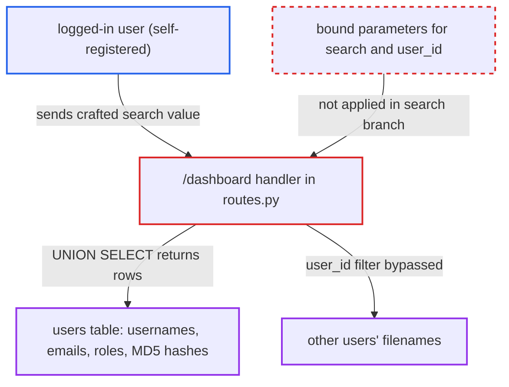

# SQL injection in dashboard file search via f-string built LIKE query

| Field | Value |
|---|---|
| ID | `find_01Rm2zwFZf7XEboUvkZY16mC` |
| Severity | **High** |
| Status | open |
| CWE | CWE-89 — SQL injection |
| Created | 2026-10-22T17:51:45.499103Z |
| Claude Security | https://claude.ai/security/findings/find_01Rm2zwFZf7XEboUvkZY16mC |

## Description

A logged-in user can read the whole SQLite database through the dashboard file search. That includes every user's username, email, role, permissions and unsalted MD5 password hash, plus every user's filenames. Anyone can get an account by self-registering at `/signup`. The `/dashboard` handler in `server/routes.py` puts the `search` parameter straight into the SQL text with an f-string.

1. **attacker** registers an account and logs in. Accounts are self-registered at `/signup`, and the only gate on `/dashboard` is that `'username'` is in the session. ([`server/routes.py:124-126`](https://github.com/cx-benchmark/threatbyte/blob/ede28f27e7e5061866a67b19b6088df4dd11c569/server/routes.py#L124-L126))
2. **attacker** sends `GET /dashboard` with a crafted `search` value. The handler reads `search_query = request.args.get('search', '')` without validating it, so a single quote in the value can close the string literal. ([`server/routes.py:124-126`](https://github.com/cx-benchmark/threatbyte/blob/ede28f27e7e5061866a67b19b6088df4dd11c569/server/routes.py#L124-L126))
3. **the `/dashboard` handler** builds the SQL text with an f-string and runs it with `cursor.execute(s_query)`. The raw `search_query` is placed inside `filename LIKE '%...%'` and no parameters are bound, so the rest of the input is read as SQL. ([`server/routes.py:137-138`](https://github.com/cx-benchmark/threatbyte/blob/ede28f27e7e5061866a67b19b6088df4dd11c569/server/routes.py#L137-L138))
4. **SQLite** returns the injected rows as if they were filenames. A `UNION SELECT` takes its column name from the first SELECT, so `row['filename']` reads every injected row. Input such as `' OR 1=1--` also removes the `user_id` filter. ([`server/routes.py:141-143`](https://github.com/cx-benchmark/threatbyte/blob/ede28f27e7e5061866a67b19b6088df4dd11c569/server/routes.py#L141-L143))
5. **template `dashboard.html`** prints each returned value in the response page. Each element of `files` is printed as `{{ file }}`, so the stolen data appears as text in the HTML. ([`client/templates/dashboard.html:33-36`](https://github.com/cx-benchmark/threatbyte/blob/ede28f27e7e5061866a67b19b6088df4dd11c569/client/templates/dashboard.html#L33-L36))

## Assessment

The attacker needs a valid login. Any Internet user can get one by registering at `/signup`, and authenticated users can reach all routes except login. They send a request such as `GET /dashboard?search=' UNION SELECT username||':'||password FROM users--`. No defense stands in the way, and the report says the exploit works reliably on any deployment. The no-search branch at `routes.py:140` uses a parameterized query, so only the search branch is exposed.

Impact: The attacker can read the entire database, including all accounts, credentials and every user's filenames. Writing is not possible through this path. The report assumes the pinned runtime `python:3.13.3-alpine`, where `execute()` runs only one statement and SQL `load_extension()` stays disabled because `enable_load_extension(True)` is never called. The attacker can also run a CPU-heavy query, such as a recursive CTE, to slow the request thread and the database.

## Recommendation

The user-controlled `search_query` is concatenated into the SQL text at `routes.py:137` instead of being bound as a parameter. The input is therefore read as SQL, and the per-user `user_id` filter can be bypassed.

Fix criteria: The search term reaches SQLite only as a bound parameter, for example `filename LIKE ?` with the `%` wildcards added to the Python value, and `user_id` is bound as well. Escaping `%` and `_` in the term is optional. A request with `search=' UNION SELECT password FROM users--`, or any other quote or comment sequence, returns only the current user's filenames that literally contain that text. No row from `users` or from other users' files appears in the response.

## Evidence

**https://github.com/cx-benchmark/threatbyte**

- [`server/routes.py:137-138`](https://github.com/cx-benchmark/threatbyte/blob/ede28f27e7e5061866a67b19b6088df4dd11c569/server/routes.py#L137-L138)
- [`server/routes.py:124-126`](https://github.com/cx-benchmark/threatbyte/blob/ede28f27e7e5061866a67b19b6088df4dd11c569/server/routes.py#L124-L126)
- [`server/routes.py:141-143`](https://github.com/cx-benchmark/threatbyte/blob/ede28f27e7e5061866a67b19b6088df4dd11c569/server/routes.py#L141-L143)
- [`client/templates/dashboard.html:33-36`](https://github.com/cx-benchmark/threatbyte/blob/ede28f27e7e5061866a67b19b6088df4dd11c569/client/templates/dashboard.html#L33-L36)
- [`server/routes.py:140`](https://github.com/cx-benchmark/threatbyte/blob/ede28f27e7e5061866a67b19b6088df4dd11c569/server/routes.py#L140)
- [`db/create_db_tables.py:7-19`](https://github.com/cx-benchmark/threatbyte/blob/ede28f27e7e5061866a67b19b6088df4dd11c569/db/create_db_tables.py#L7-L19)
- [`db/initialize_db.py:6-9`](https://github.com/cx-benchmark/threatbyte/blob/ede28f27e7e5061866a67b19b6088df4dd11c569/db/initialize_db.py#L6-L9)

