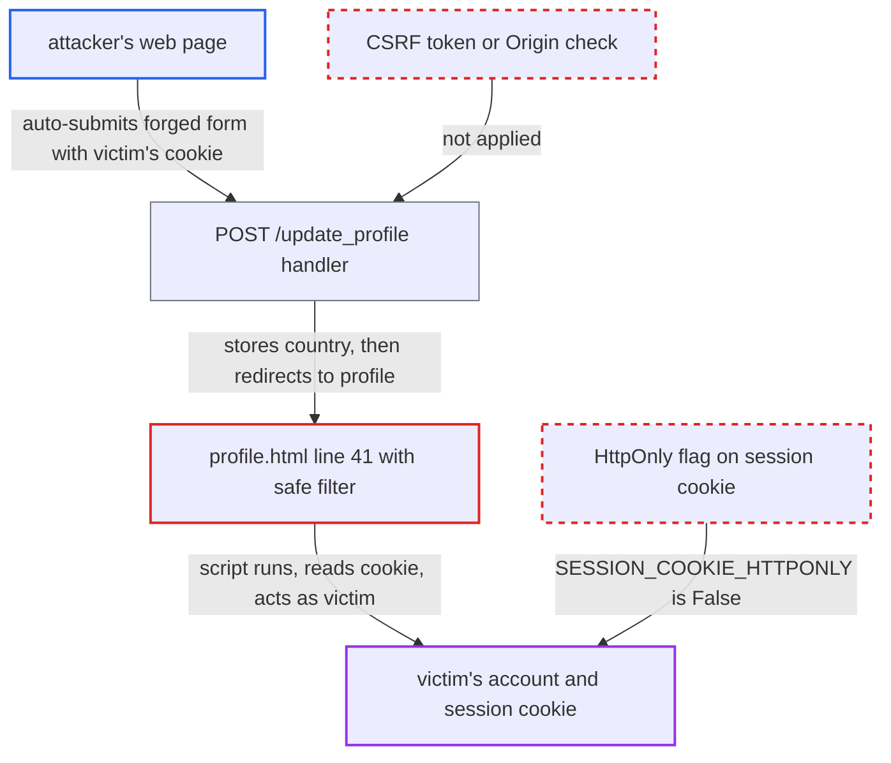

# Stored XSS via user country rendered with |safe on the profile page

| Field | Value |
|---|---|
| ID | `find_01SQCij2FEDQQrPRu1NaFYxt` |
| Severity | **High** |
| Status | open |
| CWE | CWE-79 — Cross-site scripting |
| Created | 2026-10-22T17:52:47.395225Z |
| Claude Security | https://claude.ai/security/findings/find_01SQCij2FEDQQrPRu1NaFYxt |

## Description

An attacker with no account can run script in a logged-in victim's browser on the app's own origin. The script lets the attacker take over the victim's account. The victim only has to visit the attacker's page. The profile template `profile.html` prints the stored `country` value with `| safe`, so it is not escaped. The attack is cross-user because `POST /update_profile` has no CSRF protection and `SESSION_COOKIE_HTTPONLY` is `False`.

1. **attacker** hosts a page that auto-submits a form to `/update_profile`. The form sends empty `username`, `email` and `team` fields and puts the script payload in `country`, for example an img tag with an `onerror` handler.
2. **victim's browser** sends the forged POST with the victim's session cookie. The only guard on `update_profile` is the check that a session exists. It has no CSRF token and no Origin check. ([`server/routes.py:170-173`](https://github.com/cx-benchmark/threatbyte/blob/ede28f27e7e5061866a67b19b6088df4dd11c569/server/routes.py#L170-L173))
3. **the handler for `POST /update_profile`** reads `country` straight from `request.form['country']`. The value is not validated or encoded. Empty values for the other fields fall back to the stored ones. ([`server/routes.py:184-197`](https://github.com/cx-benchmark/threatbyte/blob/ede28f27e7e5061866a67b19b6088df4dd11c569/server/routes.py#L184-L197))
4. **the handler for `POST /update_profile`** writes the payload into the victim's `users` row and redirects to `/profile`. The write is a parameterised `UPDATE`, which prevents SQL injection but does nothing about markup in the value. ([`server/routes.py:229-239`](https://github.com/cx-benchmark/threatbyte/blob/ede28f27e7e5061866a67b19b6088df4dd11c569/server/routes.py#L229-L239))
5. **the template `profile.html`** prints `user.country` unescaped. `{{ user.country | safe}}` bypasses Jinja2 autoescaping, so the payload runs at once and again on every later profile view. ([`client/templates/profile.html:41`](https://github.com/cx-benchmark/threatbyte/blob/ede28f27e7e5061866a67b19b6088df4dd11c569/client/templates/profile.html#L41))
6. **the injected script** reads the session cookie and acts as the victim. `SESSION_COOKIE_HTTPONLY = False` lets script read the cookie. The cookie is `session` under the shipped `flask run`, or `session_token` only when started via `python run.py`. ([`server/config.py:6`](https://github.com/cx-benchmark/threatbyte/blob/ede28f27e7e5061866a67b19b6088df4dd11c569/server/config.py#L6))

## Assessment

The attacker needs no account. The attacker hosts a page on any origin, and a logged-in victim only has to visit it. The cross-site POST carries the session cookie only where the victim's browser does not apply SameSite=Lax by default. Flask sets no SameSite attribute, and the report says Chromium applies Lax only within about 2 minutes of the cookie being issued. The reflected XSS on the dashboard is another way to plant the payload, and it turns one-off execution into persistent execution. The signup form and the JSON API `/api/v1/update-profile` also store `country` verbatim. They write only the caller's own row, so on their own a user can only attack themselves.

Impact: The script runs persistently as the victim in the app origin. It can read the session cookie and the victim's profile and file data. It can also edit the profile and upload, download or delete the victim's files, which is full account takeover. Deleting files is a limited loss of availability.

## Recommendation

(1) `profile.html` line 41 turns off output escaping for `country`. That column is filled from untrusted form and JSON input, so stored data is interpreted as markup.

Fix criteria: `country` is HTML-escaped when rendered, with no `| safe` on user-controlled columns and autoescaping in effect. To verify, set `country` to `` and confirm that `/profile` returns `&lt;img ...&gt;` as text and creates no element. Validating input in the writers (`routes.py` lines 83 and 186, `api_v1.py` line 190) is defence in depth only.

(2) `POST /update_profile` accepts cross-site requests, so a third party can write a victim's `country`. The session cookie is also readable from script because `SESSION_COOKIE_HTTPONLY` is `False`.

Fix criteria: State-changing profile updates reject requests that lack a valid per-session CSRF token or a same-origin Origin. The session cookie is HttpOnly. To verify, a cross-origin auto-submitted form does not change the victim's row. `document.cookie` does not expose the session.

## Evidence

**https://github.com/cx-benchmark/threatbyte**

- [`client/templates/profile.html:41`](https://github.com/cx-benchmark/threatbyte/blob/ede28f27e7e5061866a67b19b6088df4dd11c569/client/templates/profile.html#L41)
- [`server/routes.py:184-197`](https://github.com/cx-benchmark/threatbyte/blob/ede28f27e7e5061866a67b19b6088df4dd11c569/server/routes.py#L184-L197)
- [`server/routes.py:229-239`](https://github.com/cx-benchmark/threatbyte/blob/ede28f27e7e5061866a67b19b6088df4dd11c569/server/routes.py#L229-L239)
- [`server/routes.py:170-173`](https://github.com/cx-benchmark/threatbyte/blob/ede28f27e7e5061866a67b19b6088df4dd11c569/server/routes.py#L170-L173)
- [`server/routes.py:147-152`](https://github.com/cx-benchmark/threatbyte/blob/ede28f27e7e5061866a67b19b6088df4dd11c569/server/routes.py#L147-L152)
- [`server/routes.py:81-99`](https://github.com/cx-benchmark/threatbyte/blob/ede28f27e7e5061866a67b19b6088df4dd11c569/server/routes.py#L81-L99)
- [`server/config.py:6`](https://github.com/cx-benchmark/threatbyte/blob/ede28f27e7e5061866a67b19b6088df4dd11c569/server/config.py#L6)

