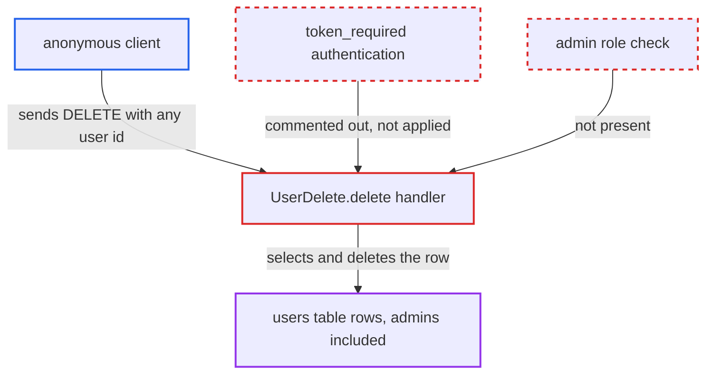

# Unauthenticated deletion of any user via /api/v1/delete-user/<user_id>

| Field | Value |
|---|---|
| ID | `find_01RCpcVcnBLwDX6jHmA1zXuc` |
| Severity | **High** |
| Status | open |
| CWE | CWE-862 — Missing Authorization |
| Created | 2026-10-22T17:52:30.775966Z |
| Claude Security | https://claude.ai/security/findings/find_01RCpcVcnBLwDX6jHmA1zXuc |

## Description

Any anonymous client can permanently delete any user account, admins included, and can empty the `users` table by trying ids in turn. No login, token or victim action is needed. The handler `UserDelete.delete` deletes the row for the `user_id` in the URL without checking who is calling, because the `@token_required` decorator is commented out.

1. **anonymous client** sends a DELETE request to `/api/v1/delete-user/1`. The route is published in `swagger.json` with only `user_id` as a parameter and no security definition, so nothing is required to call it. ([`server/api/v1/docs/swagger.json:5-36`](https://github.com/cx-benchmark/threatbyte/blob/ede28f27e7e5061866a67b19b6088df4dd11c569/server/api/v1/docs/swagger.json#L5-L36))
2. **the handler `UserDelete.delete`** accepts the request without identifying the caller. The `@token_required` decorator and the `current_user` signature are commented out, so the handler runs for any anonymous request. ([`server/api/v1/api_v1.py:221-222`](https://github.com/cx-benchmark/threatbyte/blob/ede28f27e7e5061866a67b19b6088df4dd11c569/server/api/v1/api_v1.py#L221-L222))
3. **the handler `UserDelete.delete`** selects the row for the path-supplied `user_id` and deletes it. There is no admin role check and no check that the id belongs to the caller. The handler returns `User deleted successfully`. ([`server/api/v1/api_v1.py:223-233`](https://github.com/cx-benchmark/threatbyte/blob/ede28f27e7e5061866a67b19b6088df4dd11c569/server/api/v1/api_v1.py#L223-L233))
4. **anonymous client** repeats the request with ids 2, 3 and so on. The 200 and 404 responses show which ids exist, and the attacker can keep going until the `users` table is empty.
5. **anonymous client** re-registers a freed username or email through `/signup`. The `username` and `email` of a deleted user become free. A victim's still-valid session cookie then acts on the attacker's new account, because the web routes resolve the account from `session['username']`.

## Assessment

The attacker is any anonymous client that can reach the app over the network. The Dockerfile runs `flask run` bound to 0.0.0.0:5000. The attacker needs no token, cookie or victim action. They send `DELETE /api/v1/delete-user/<user_id>` with ids from 1 upward. The Flask app registers no `before_request` hook or other auth middleware, and `token_required` is not applied to any route in the repository. A second effect follows from the deletion. `id` is `AUTOINCREMENT`, so ids are never reused, but the freed `username` and `email` can be registered again through `/signup`.

Impact: The attacker can permanently destroy every account in `users`, admins included. Every existing user loses access to their account and files, and recovery needs a database restore. SQLite's `PRAGMA foreign_keys` is never enabled, so the delete always succeeds. The victim's `files` rows and on-disk files are left orphaned. The service keeps running for new sign-ups, and no stored data is disclosed beyond which ids exist.

## Recommendation

`UserDelete.delete` runs a destructive, privileged operation on an attacker-chosen `user_id` without establishing who the caller is or whether they may delete that user.

Fix criteria: The endpoint requires an authenticated caller and allows deletion only by an administrator, or by the account owner if that is intended. An unauthenticated DELETE returns 401. A non-admin user deleting another id gets 403 and the row stays intact. Only an admin, or the owner, can remove the row.

## Evidence

**https://github.com/cx-benchmark/threatbyte**

- [`server/api/v1/api_v1.py:223-233`](https://github.com/cx-benchmark/threatbyte/blob/ede28f27e7e5061866a67b19b6088df4dd11c569/server/api/v1/api_v1.py#L223-L233)
- [`server/api/v1/api_v1.py:221-222`](https://github.com/cx-benchmark/threatbyte/blob/ede28f27e7e5061866a67b19b6088df4dd11c569/server/api/v1/api_v1.py#L221-L222)
- [`server/api/v1/api_v1.py:215-219`](https://github.com/cx-benchmark/threatbyte/blob/ede28f27e7e5061866a67b19b6088df4dd11c569/server/api/v1/api_v1.py#L215-L219)
- [`server/api/v1/docs/swagger.json:5-36`](https://github.com/cx-benchmark/threatbyte/blob/ede28f27e7e5061866a67b19b6088df4dd11c569/server/api/v1/docs/swagger.json#L5-L36)

