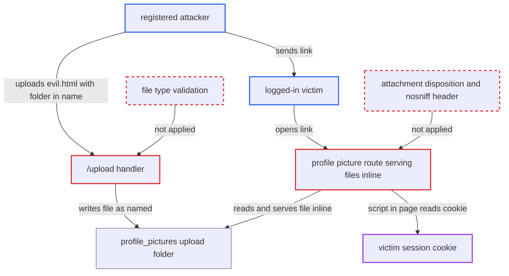

# Unrestricted file type upload served inline enables stored XSS and session theft

| Field | Value |
|---|---|
| ID | `find_01TJRBcnuf6MpdjJv1DcL5wL` |
| Severity | **High** |
| Status | open |
| CWE | CWE-434 — Unrestricted file upload |
| Created | 2026-10-22T17:53:38.671105Z |
| Claude Security | https://claude.ai/security/findings/find_01TJRBcnuf6MpdjJv1DcL5wL |

## Description

A registered user can store an HTML or SVG file on the server. When a logged-in victim opens the link, the file's script runs in the victim's browser on the app's origin and steals the session cookie. The attacker then acts as that victim, including an admin. The cause is `/upload` in `server/routes.py`, which accepts any file type and keeps the client's name. The serving routes then send the file inline.

1. **attacker** signs up and posts a file to `/upload` named `profile_pictures/evil.html`. The handler keeps the client's `file.filename` unchanged. It has no extension allow-list and no content check, and the name can contain a folder separator. ([`server/routes.py:261-264`](https://github.com/cx-benchmark/threatbyte/blob/ede28f27e7e5061866a67b19b6088df4dd11c569/server/routes.py#L261-L264))
2. **the handler `/upload`** writes the file into the profile-picture folder. The unsanitised name places `evil.html` in `server/uploads/profile_pictures/`, which is served publicly. The body can be a script that sends `document.cookie` to the attacker. ([`server/routes.py:262-263`](https://github.com/cx-benchmark/threatbyte/blob/ede28f27e7e5061866a67b19b6088df4dd11c569/server/routes.py#L262-L263))
3. **attacker** sends the victim a link to `/uploads/profile_pictures/evil.html`. The victim only has to open the link while logged in.
4. **the route `/uploads/profile_pictures/<filename>`** returns the file through `send_from_directory` as `text/html`. The route needs no login. It does not request `as_attachment` and sets no `X-Content-Type-Options` header, so the browser renders the file as a page of the app. ([`server/routes.py:307-309`](https://github.com/cx-benchmark/threatbyte/blob/ede28f27e7e5061866a67b19b6088df4dd11c569/server/routes.py#L307-L309))
5. **the attacker's script** reads the session cookie and sends it to the attacker. `SESSION_COOKIE_HTTPONLY` is `False`, so script on the app's origin can read the cookie. The attacker replays it to act as the victim. ([`server/config.py:6`](https://github.com/cx-benchmark/threatbyte/blob/ede28f27e7e5061866a67b19b6088df4dd11c569/server/config.py#L6))

## Assessment

The attacker is any registered user, since `/signup` is open. The victim must be logged in and open the attacker's link, with no other action. The profile-picture route needs no login, so it also reaches visitors who are not logged in. A second way in is the shared upload directory. Ownership is keyed by file name, so a victim who owns a file with the same name is served the attacker's content through `/uploads/<filename>`. The report files that collision separately. `/download/<filename>` at line 334 also serves files inline. The `../` traversal finding is independent of this one. Using `secure_filename()` alone would still accept and serve `evil.html`.

Impact: The attacker takes over the victim's account, including admin accounts. They can read the victim's profile and files, and change or delete them. They can also change role or permissions through `/update_profile`. The report says service availability is unaffected.

## Recommendation

(1) `/upload` accepts any file and stores it under the client's name and extension (`server/routes.py:261-264`), so active content such as HTML or SVG enters storage.

Fix criteria: Only file types the application means to host can be stored. The stored extension and Content-Type are chosen by the server, using an extension allow-list plus a content check, and are not taken from the client. Uploading `evil.html` or `evil.svg` is rejected, or the file is stored so it cannot be served as an active document.

(2) Stored uploads are sent inline with a Content-Type guessed from the attacker-controlled extension (`server/routes.py:302`, `309`, `334`), so the browser runs them on the application's origin.

Fix criteria: Browsers never render user content as a page of the app's origin. This is done with `Content-Disposition: attachment`, `X-Content-Type-Options: nosniff`, and/or a fixed non-executable content type or a separate origin. Fetching a stored `.html` upload does not run script in the browser.

## Evidence

**https://github.com/cx-benchmark/threatbyte**

- [`server/routes.py:261-264`](https://github.com/cx-benchmark/threatbyte/blob/ede28f27e7e5061866a67b19b6088df4dd11c569/server/routes.py#L261-L264)
- [`server/routes.py:307-309`](https://github.com/cx-benchmark/threatbyte/blob/ede28f27e7e5061866a67b19b6088df4dd11c569/server/routes.py#L307-L309)
- [`server/routes.py:302`](https://github.com/cx-benchmark/threatbyte/blob/ede28f27e7e5061866a67b19b6088df4dd11c569/server/routes.py#L302)
- [`server/config.py:6`](https://github.com/cx-benchmark/threatbyte/blob/ede28f27e7e5061866a67b19b6088df4dd11c569/server/config.py#L6)
- [`server/routes.py:262-263`](https://github.com/cx-benchmark/threatbyte/blob/ede28f27e7e5061866a67b19b6088df4dd11c569/server/routes.py#L262-L263)

