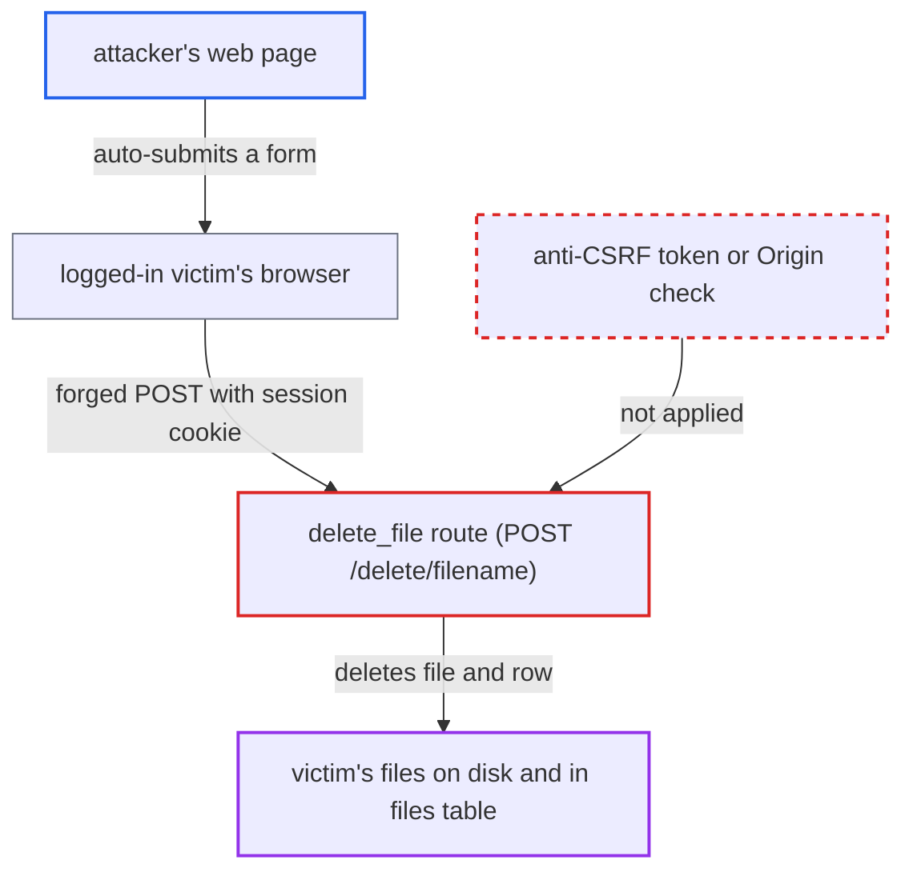

# CSRF on POST /delete/<filename> deletes a victim's files from a third-party page

| Field | Value |
|---|---|
| ID | `find_018NxfTT1BNV2Q8eoMxNP4ey` |
| Severity | **Medium** |
| Status | open |
| CWE | CWE-352 — Cross-site request forgery |
| Created | 2026-10-22T17:52:30.663617Z |
| Claude Security | https://claude.ai/security/findings/find_018NxfTT1BNV2Q8eoMxNP4ey |

## Description

Anyone who can get a logged-in user to open a page they control can delete that user's uploaded files, permanently. No account is needed, but the attacker must know or guess the filename. The route `delete_file` in `server/routes.py` acts on the session cookie alone and has no anti-CSRF check.

1. **attacker** hosts a page that auto-submits a form. The form is a POST to `https://<app>/delete/<filename>` with no body, and it names a file the attacker knows or guesses, since upload names are kept verbatim.
2. **victim's browser** sends the forged POST with the session cookie. `Config` sets no `SESSION_COOKIE_SAMESITE`, so the cookie has no `SameSite` attribute. Firefox and Safari then send it on a cross-site POST. Chromium sends it only within its two-minute Lax+POST window after the cookie is set. ([`server/config.py:4-10`](https://github.com/cx-benchmark/threatbyte/blob/ede28f27e7e5061866a67b19b6088df4dd11c569/server/config.py#L4-L10))
3. **the route `delete_file`** accepts the request on the session alone. The only check is `'username' in session`. It looks for no anti-CSRF token, `Origin`/`Referer` header or custom header, so a cross-origin form is accepted. ([`server/routes.py:340-344`](https://github.com/cx-benchmark/threatbyte/blob/ede28f27e7e5061866a67b19b6088df4dd11c569/server/routes.py#L340-L344))
4. **the route `delete_file`** removes the file and its database row. It finds the `files` row by filename and the victim's user id, then calls `os.remove` on the file in `UPLOAD_FOLDER` and deletes the row. The code has no recovery or soft-delete. ([`server/routes.py:354-367`](https://github.com/cx-benchmark/threatbyte/blob/ede28f27e7e5061866a67b19b6088df4dd11c569/server/routes.py#L354-L367))

## Assessment

The attacker needs no account. They need a logged-in victim to open a page the attacker controls, and they must know or guess the target filename. The browser must also send the cookie on the cross-site POST. That happens in browsers without Lax-by-default (Firefox, Safari). It also happens in Chromium if the login was recent, inside the Lax+POST window. The cookie is named `session` under the shipped `flask run` and `session_token` when started as `python run.py`. The attacker cannot read the response, but the deletion has already happened.

Impact: The attacker permanently destroys stored files that belong to the victim, one named file per forged request. The attacker reads nothing back, and the service stays up.

## Recommendation

`delete_file` in `server/routes.py` deletes a file because the session cookie is present, so a forged cross-origin request looks the same as the user's own click.

Fix criteria: Deletion requires a per-session anti-CSRF token, sent by the dashboard script in a custom header or body field. The server checks the token before any lookup or removal and rejects requests without it. A POST to `/delete/<name>` from a foreign origin with a valid cookie leaves the file in place. Setting `SESSION_COOKIE_SAMESITE=Lax` is worthwhile as defence in depth, but it does not replace the token.

## Evidence

**https://github.com/cx-benchmark/threatbyte**

- [`server/routes.py:340-344`](https://github.com/cx-benchmark/threatbyte/blob/ede28f27e7e5061866a67b19b6088df4dd11c569/server/routes.py#L340-L344)
- [`server/routes.py:354-367`](https://github.com/cx-benchmark/threatbyte/blob/ede28f27e7e5061866a67b19b6088df4dd11c569/server/routes.py#L354-L367)
- [`server/config.py:4-10`](https://github.com/cx-benchmark/threatbyte/blob/ede28f27e7e5061866a67b19b6088df4dd11c569/server/config.py#L4-L10)
- [`client/templates/dashboard.html:84-104`](https://github.com/cx-benchmark/threatbyte/blob/ede28f27e7e5061866a67b19b6088df4dd11c569/client/templates/dashboard.html#L84-L104)

