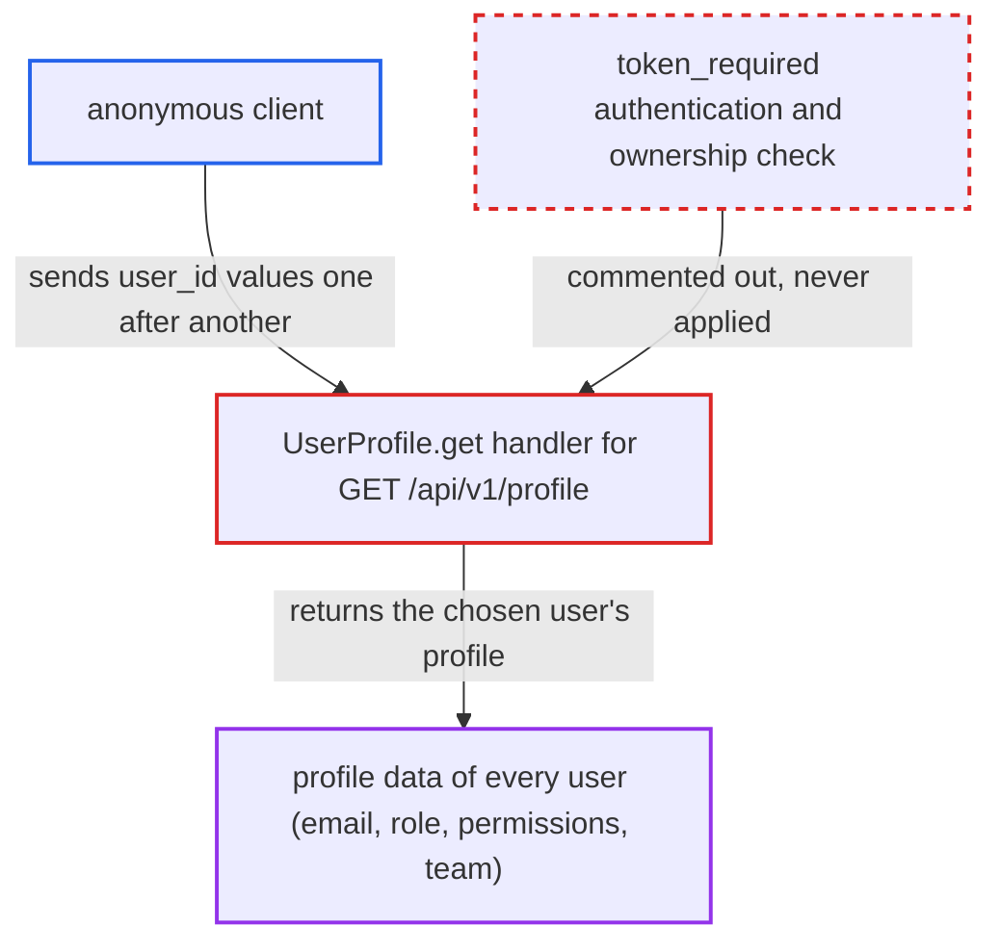

# Unauthenticated BOLA: /api/v1/profile returns any user's profile by user_id

| Field | Value |
|---|---|
| ID | `find_011GoqYU2MoVDo82TyQsuFi8` |
| Severity | **Medium** |
| Status | open |
| CWE | CWE-639 — Insecure Direct Object Reference |
| Created | 2026-10-22T17:52:12.830630Z |
| Claude Security | https://claude.ai/security/findings/find_011GoqYU2MoVDo82TyQsuFi8 |

## Description

An anonymous client can read the profile of every user: `username`, `email`, `country`, `role`, `permissions` and `team`. This includes which accounts are admins. No login is needed, and the disclosure is limited to profile data because the password hash is not returned. The handler `UserProfile.get` has its authentication decorator commented out. It also never compares `user_id` with a caller identity.

1. **anonymous attacker** sends `GET /api/v1/profile?user_id=1` with no token or cookie. The `@token_required` decorator and the `current_user` parameter are commented out, so the route accepts requests with no credentials. ([`server/api/v1/api_v1.py:152-154`](https://github.com/cx-benchmark/threatbyte/blob/ede28f27e7e5061866a67b19b6088df4dd11c569/server/api/v1/api_v1.py#L152-L154))
2. **Flask app** routes the request to the API without any other authorization layer. The API is registered on the shipped app, and the report finds no `before_request` or API-level authorization elsewhere. ([`server/__init__.py:16`](https://github.com/cx-benchmark/threatbyte/blob/ede28f27e7e5061866a67b19b6088df4dd11c569/server/__init__.py#L16))
3. **the handler `UserProfile.get`** reads `user_id` from the query string and selects that user's row. The query is parameterised, so there is no SQL injection, but it is keyed on the id the caller supplied and on no caller identity. ([`server/api/v1/api_v1.py:158-168`](https://github.com/cx-benchmark/threatbyte/blob/ede28f27e7e5061866a67b19b6088df4dd11c569/server/api/v1/api_v1.py#L158-L168))
4. **the handler `UserProfile.get`** returns the selected row as JSON. The response holds `username`, `email`, `country`, `role`, `permissions` and `team` for the requested user. ([`server/api/v1/api_v1.py:158-168`](https://github.com/cx-benchmark/threatbyte/blob/ede28f27e7e5061866a67b19b6088df4dd11c569/server/api/v1/api_v1.py#L158-L168))
5. **anonymous attacker** repeats the request with `user_id=2`, `3` and so on. User ids are small sequential integers, so the whole user base can be enumerated.

## Assessment

The attacker is anonymous and needs only network access to the API, which the Dockerfile runs with `flask run` on 0.0.0.0:5000. The attacker calls `GET /api/v1/profile?user_id=<n>` for each id. The report notes that the harvested usernames help with other unauthenticated flaws. `/update_picture` is keyed by `username`, and `/login` has no brute-force protection. The admin list also shows which accounts to target.

Impact: The attacker can list every user's username, e-mail address, country, team, role and permissions. Password hashes and files are not exposed by this route, so the loss is limited to profile data.

## Recommendation

`UserProfile.get` selects the record by the caller-supplied `user_id` with no authentication and no ownership or role check. This breaks object-level authorization.

Fix criteria: The endpoint requires an authenticated principal and returns only that principal's profile, unless the caller has an admin role for other ids. An unauthenticated request returns 401. An authenticated non-admin requesting another `user_id` gets 403 and no profile data.

## Evidence

**https://github.com/cx-benchmark/threatbyte**

- [`server/api/v1/api_v1.py:158-168`](https://github.com/cx-benchmark/threatbyte/blob/ede28f27e7e5061866a67b19b6088df4dd11c569/server/api/v1/api_v1.py#L158-L168)
- [`server/api/v1/api_v1.py:152-154`](https://github.com/cx-benchmark/threatbyte/blob/ede28f27e7e5061866a67b19b6088df4dd11c569/server/api/v1/api_v1.py#L152-L154)
- [`server/__init__.py:16`](https://github.com/cx-benchmark/threatbyte/blob/ede28f27e7e5061866a67b19b6088df4dd11c569/server/__init__.py#L16)
- [`server/api/v1/docs/swagger.json:73-103`](https://github.com/cx-benchmark/threatbyte/blob/ede28f27e7e5061866a67b19b6088df4dd11c569/server/api/v1/docs/swagger.json#L73-L103)

