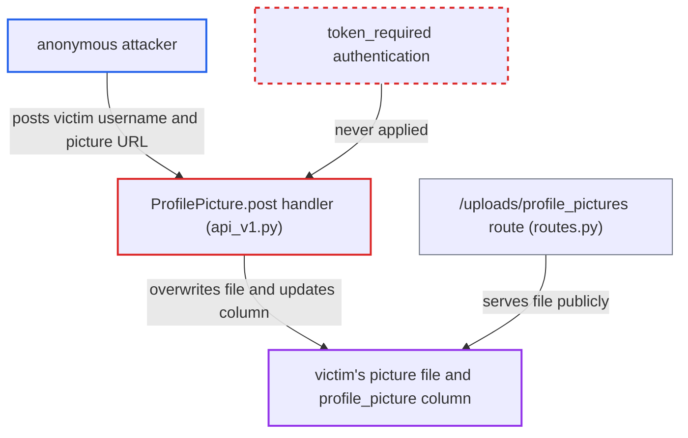

# Unauthenticated replacement of any user's profile picture via /api/v1/update_picture

| Field | Value |
|---|---|
| ID | `find_01EscsQXPRSsGdHNR6vjMfNs` |
| Severity | **Medium** |
| Status | open |
| CWE | CWE-639 — Insecure Direct Object Reference |
| Created | 2026-10-22T17:52:12.748576Z |
| Claude Security | https://claude.ai/security/findings/find_01EscsQXPRSsGdHNR6vjMfNs |

## Description

Anyone on the network, with no login, can replace any user's profile picture, administrators included. The attacker can also store arbitrary bytes in a publicly served directory. The handler `ProfilePicture.post` trusts the `username` in the request body and never authenticates the caller or checks account ownership. The impact is limited to the picture file and the `profile_picture` column.

1. **attacker** hosts a file on their own server and picks a victim's username. The server only has to return an `image/jpeg` or `image/png` Content-Type header. The body can be any bytes. Usernames can be listed through the unauthenticated `/api/v1/profile` route.
2. **attacker** sends a POST to `/api/v1/update_picture` with the victim's `username` and a `picture_url`. `token_required` is never applied to this handler, and `username` is read straight from `api.payload`, so the caller chooses whose record is changed. ([`server/api/v1/api_v1.py:240-250`](https://github.com/cx-benchmark/threatbyte/blob/ede28f27e7e5061866a67b19b6088df4dd11c569/server/api/v1/api_v1.py#L240-L250))
3. **the handler `ProfilePicture.post`** fetches the URL and looks up the victim by the supplied `username`. The only gate is the Content-Type header check. The body is not inspected. The lookup returns the victim's row and current `profile_picture` id. ([`server/api/v1/api_v1.py:266-271`](https://github.com/cx-benchmark/threatbyte/blob/ede28f27e7e5061866a67b19b6088df4dd11c569/server/api/v1/api_v1.py#L266-L271))
4. **the handler `ProfilePicture.post`** overwrites the victim's picture file and updates the `profile_picture` column. The downloaded bytes are written over `<victim_picture_id>.png`, or a new id is allocated. Nothing checks that the caller is the victim or an admin. ([`server/api/v1/api_v1.py:282-289`](https://github.com/cx-benchmark/threatbyte/blob/ede28f27e7e5061866a67b19b6088df4dd11c569/server/api/v1/api_v1.py#L282-L289))
5. **the route in `routes.py`** serves the written file to everyone from `/uploads/profile_pictures/<filename>`. The file is served as `image/png`, and `client/templates/profile.html` embeds it on the victim's profile page. ([`server/routes.py:307-309`](https://github.com/cx-benchmark/threatbyte/blob/ede28f27e7e5061866a67b19b6088df4dd11c569/server/routes.py#L307-L309))

## Assessment

The attacker is an anonymous client who can reach the API over the network. No credentials, special setting or victim action is needed. They need a server they control that returns an image Content-Type header, and a victim's username. Usernames can be enumerated through the unauthenticated `/api/v1/profile` route. The report treats this as separate from the SSRF in the same handler. Fixing URL validation does not fix this flaw, and fixing this flaw does not fix the SSRF.

Impact: The attacker can change the profile picture of any user, including administrators, and put content of their choosing on that user's profile page. They can also place arbitrary bytes of unbounded size in a publicly served directory. Account credentials, roles and other uploaded files are not affected, so the integrity loss is limited.

## Recommendation

(1) `ProfilePicture.post` changes the record selected by a caller-supplied `username`. It does not authenticate the caller or check that they own that account.

Fix criteria: The endpoint requires an authenticated principal. It takes the target account from that principal and ignores any `username` in the body, or it requires an admin role to act on other users. An unauthenticated POST returns 401. An authenticated user who names another username cannot change that user's picture file or `profile_picture` column.

(2) The downloaded body is stored after only a Content-Type header substring check. Arbitrary attacker bytes of any size end up in a publicly served directory.

Fix criteria: Stored content is validated as a real image, by magic bytes or by decoding it, and its size is bounded before anything is written. A non-image body served with an image Content-Type is rejected and nothing is written.

## Evidence

**https://github.com/cx-benchmark/threatbyte**

- [`server/api/v1/api_v1.py:240-250`](https://github.com/cx-benchmark/threatbyte/blob/ede28f27e7e5061866a67b19b6088df4dd11c569/server/api/v1/api_v1.py#L240-L250)
- [`server/api/v1/api_v1.py:266-271`](https://github.com/cx-benchmark/threatbyte/blob/ede28f27e7e5061866a67b19b6088df4dd11c569/server/api/v1/api_v1.py#L266-L271)
- [`server/api/v1/api_v1.py:282-289`](https://github.com/cx-benchmark/threatbyte/blob/ede28f27e7e5061866a67b19b6088df4dd11c569/server/api/v1/api_v1.py#L282-L289)
- [`server/routes.py:307-309`](https://github.com/cx-benchmark/threatbyte/blob/ede28f27e7e5061866a67b19b6088df4dd11c569/server/routes.py#L307-L309)

