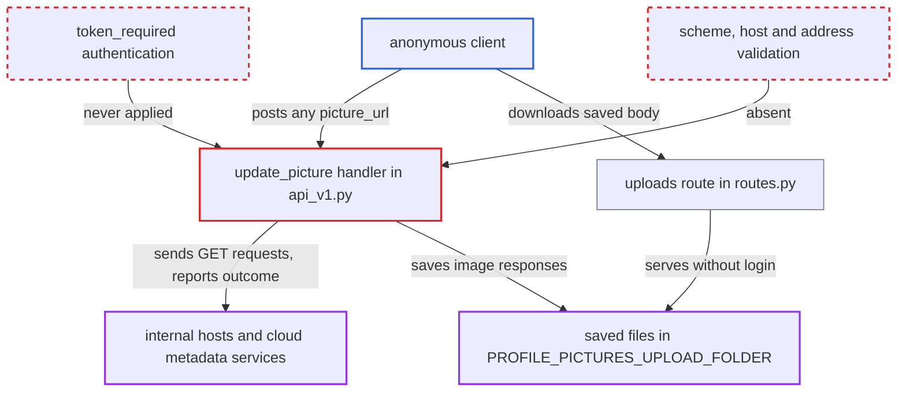

# Unauthenticated SSRF via user-supplied picture_url in /api/v1/update_picture

| Field | Value |
|---|---|
| ID | `find_01XVNtEUj9x48Uzt7oYWMgpT` |
| Severity | **Medium** |
| Status | open |
| CWE | CWE-918 — Server-Side Request Forgery |
| Created | 2026-10-22T17:52:30.566500Z |
| Claude Security | https://claude.ai/security/findings/find_01XVNtEUj9x48Uzt7oYWMgpT |

## Description

Anyone on the internet, with no login, can make the server send GET requests to addresses it can reach internally, such as other containers, cloud metadata services or localhost admin pages. The attacker also learns whether each target answered. Image responses can be read in full. The cause is `picture_url` going unchecked into `requests.get()` in the `/api/v1/update_picture` handler, which has no authentication.

1. **anonymous client** posts a JSON body to `/api/v1/update_picture`. The `ProfilePicture` resource has no authentication decorator, so no credentials are needed. It reads `username` and `picture_url` straight from `api.payload`. ([`server/api/v1/api_v1.py:240-250`](https://github.com/cx-benchmark/threatbyte/blob/ede28f27e7e5061866a67b19b6088df4dd11c569/server/api/v1/api_v1.py#L240-L250))
2. **the handler in `api_v1.py`** calls `requests.get()` on the raw `picture_url`. There is no scheme or host check, no block on loopback, private or link-local addresses, and no timeout. Redirects are followed, which the report assumes is the default for the pinned `requests==2.32.3`. ([`server/api/v1/api_v1.py:254`](https://github.com/cx-benchmark/threatbyte/blob/ede28f27e7e5061866a67b19b6088df4dd11c569/server/api/v1/api_v1.py#L254))
3. **the server** sends the GET request to the internal target the attacker named. The request goes out before the `username` lookup, so it works even with a username that does not exist. ([`server/api/v1/api_v1.py:254`](https://github.com/cx-benchmark/threatbyte/blob/ede28f27e7e5061866a67b19b6088df4dd11c569/server/api/v1/api_v1.py#L254))
4. **the handler** returns distinct messages for each outcome. Non-200 replies, non-image replies and image replies each get a different message. This tells the attacker whether each internal URL answered 200 and what kind of content it returned. ([`server/api/v1/api_v1.py:256-296`](https://github.com/cx-benchmark/threatbyte/blob/ede28f27e7e5061866a67b19b6088df4dd11c569/server/api/v1/api_v1.py#L256-L296))
5. **the `except` block** returns `str(e)` to the caller. A refused connection, a timeout and a DNS failure each give a different message naming the host and port. `OSError`s also leak the absolute upload path. ([`server/api/v1/api_v1.py:297-298`](https://github.com/cx-benchmark/threatbyte/blob/ede28f27e7e5061866a67b19b6088df4dd11c569/server/api/v1/api_v1.py#L297-L298))
6. **the handler** writes the full response body to `<profile_picture_id>.png` under `PROFILE_PICTURES_UPLOAD_FOLDER`. This happens only when the target's Content-Type contains `image/jpeg` or `image/png` and `username` names an existing user. The body is buffered whole, with no size limit. ([`server/api/v1/api_v1.py:282-285`](https://github.com/cx-benchmark/threatbyte/blob/ede28f27e7e5061866a67b19b6088df4dd11c569/server/api/v1/api_v1.py#L282-L285))
7. **anonymous client** downloads the saved file from the `/uploads/profile_pictures/<filename>` route. That route serves the folder with no authentication, and picture ids are small sequential integers, so the file is easy to find. ([`server/routes.py:307-309`](https://github.com/cx-benchmark/threatbyte/blob/ede28f27e7e5061866a67b19b6088df4dd11c569/server/routes.py#L307-L309))

## Assessment

The attacker is an anonymous client that can reach the API. No credentials or victim action are needed. They POST a `username` and a `picture_url` such as a cloud metadata address to `/api/v1/update_picture`. Probing works even if the `username` does not exist. Reading a response body back needs an existing `username` and a target that returns an image Content-Type. Other responses are only visible through the differing messages. A slow target can also tie up a worker, because no timeout is set.

Impact: The attacker can probe which hosts and ports the server can reach and which URLs answer 200. They can also read the full body of any internal response served as an image, because it is saved to a publicly served file. The report does not establish code execution or data modification on the host. Error strings leak the absolute profile-picture path, and unbounded body size can fill the disk.

Subsequent-system impact: The server sends attacker-chosen GET requests to internal hosts it can reach. The attacker learns whether a host or port is live and the HTTP status of any internal URL. Bodies served with an image Content-Type can be exfiltrated. Non-image bodies are not returned, so disclosure is limited. The report does not show state changes on internal services.

## Recommendation

(1) `picture_url` is passed to `requests.get` at `api_v1.py:254` without restricting scheme, host, resolved addresses or redirects. The server can therefore be pointed at internal or local destinations.

Fix criteria: Only `http` or `https` URLs whose resolved addresses are public can be fetched. Loopback, RFC1918, link-local and the metadata range are refused. Redirects are re-validated or disabled, and a timeout and a maximum body size are enforced. Sending `picture_url` values `http://127.0.0.1:5000/`, `http://169.254.169.254/` and an external URL that redirects to an internal host are all rejected before any connection is made.

(2) The `except` block at `api_v1.py:297-298` returns `str(e)`. The branches at `api_v1.py:257-296` also return distinguishable messages. Together they give the attacker a precise oracle about the internal target.

Fix criteria: Client responses no longer reveal connection-level error details, the target's status code or its Content-Type. One generic failure message is returned and the details are logged on the server. A refused connection, a DNS failure and a non-200 reply all produce the same client-visible response.

(3) The endpoint is reachable without authentication because `token_required` is never applied to it, so anyone can use the SSRF.

Fix criteria: The endpoint requires an authenticated principal. An unauthenticated POST to `/api/v1/update_picture` is rejected with 401 before any URL is fetched.

## Evidence

**https://github.com/cx-benchmark/threatbyte**

- [`server/api/v1/api_v1.py:254`](https://github.com/cx-benchmark/threatbyte/blob/ede28f27e7e5061866a67b19b6088df4dd11c569/server/api/v1/api_v1.py#L254)
- [`server/api/v1/api_v1.py:240-250`](https://github.com/cx-benchmark/threatbyte/blob/ede28f27e7e5061866a67b19b6088df4dd11c569/server/api/v1/api_v1.py#L240-L250)
- [`server/api/v1/api_v1.py:297-298`](https://github.com/cx-benchmark/threatbyte/blob/ede28f27e7e5061866a67b19b6088df4dd11c569/server/api/v1/api_v1.py#L297-L298)
- [`server/api/v1/api_v1.py:256-296`](https://github.com/cx-benchmark/threatbyte/blob/ede28f27e7e5061866a67b19b6088df4dd11c569/server/api/v1/api_v1.py#L256-L296)
- [`server/api/v1/api_v1.py:282-285`](https://github.com/cx-benchmark/threatbyte/blob/ede28f27e7e5061866a67b19b6088df4dd11c569/server/api/v1/api_v1.py#L282-L285)
- [`server/routes.py:307-309`](https://github.com/cx-benchmark/threatbyte/blob/ede28f27e7e5061866a67b19b6088df4dd11c569/server/routes.py#L307-L309)

