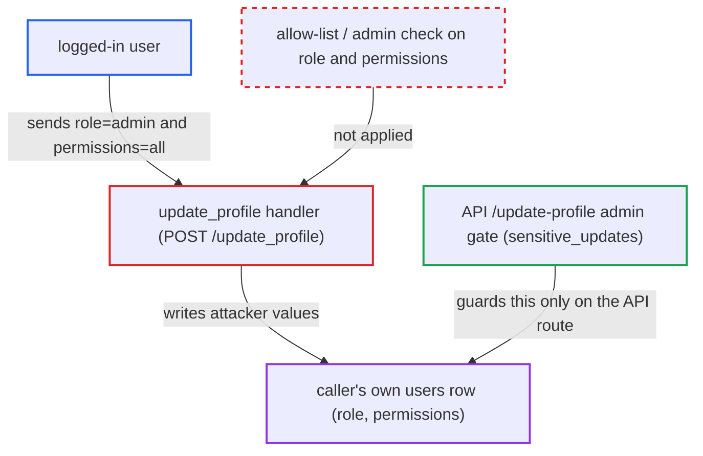

# Users can grant themselves admin role and permissions via update_profile form fields

| Field | Value |
|---|---|
| ID | `find_01PHfpbKjt1gnPNzvwUZi5RE` |
| Severity | **Medium** |
| Status | open |
| CWE | CWE-915 — Mass assignment |
| Created | 2026-10-22T17:52:12.670059Z |
| Claude Security | https://claude.ai/security/findings/find_01PHfpbKjt1gnPNzvwUZi5RE |

## Description

Any logged-in user can set their own `role` and `permissions` to any value, including `admin` and `all`. The attacker only needs an account, and `/signup` lets anyone self-register. The handler for `POST /update_profile` copies both fields from the form with no role check. The effect is limited to the caller's own row, and no other admin-only function in this repository is unlocked.

1. **attacker** registers an account and logs in. Any user with a session passes the only guard on the route, and `/signup` allows self-registration. ([`server/routes.py:170-173`](https://github.com/cx-benchmark/threatbyte/blob/ede28f27e7e5061866a67b19b6088df4dd11c569/server/routes.py#L170-L173))
2. **attacker** sends `POST /update_profile` with extra fields `role=admin&permissions=all`. The request also carries the required `username`, `email`, `country` and `team` fields, because the handler reads them with `request.form[...]` and fails without them.
3. **the `update_profile` handler** copies `role` and `permissions` from the form. It takes `role` from `request.form['role']` and `permissions` from `request.form['permissions']` whenever the key is present, with no check of the caller's current role and no allow-list of editable columns. ([`server/routes.py:187-196`](https://github.com/cx-benchmark/threatbyte/blob/ede28f27e7e5061866a67b19b6088df4dd11c569/server/routes.py#L187-L196))
4. **the `update_profile` handler** writes both values to the caller's `users` row. The UPDATE stores the attacker-supplied values in the row of the logged-in user. ([`server/routes.py:229-234`](https://github.com/cx-benchmark/threatbyte/blob/ede28f27e7e5061866a67b19b6088df4dd11c569/server/routes.py#L229-L234))
5. **attacker** now appears as an admin and passes the API's admin gate. `/profile` and `GET /api/v1/profile?user_id=<id>` show `role: admin`, and the check at `api_v1.py:201` passes for the attacker. ([`server/api/v1/api_v1.py:190-202`](https://github.com/cx-benchmark/threatbyte/blob/ede28f27e7e5061866a67b19b6088df4dd11c569/server/api/v1/api_v1.py#L190-L202))

## Assessment

The attacker is any user with a session, for example one who self-registered through `/signup`. They send a form-encoded or multipart `POST /update_profile` with the required fields plus `role=admin&permissions=all`. No other defense stands in the way. The only protection is that the `role` and `permissions` inputs are commented out of `client/templates/edit_profile.html`, and that is trivially bypassed by sending the fields by hand.

Impact: The attacker can give themselves any role or permissions string, including the admin values `role='admin'` and `permissions='all'`. This corrupts the authorization data and defeats the rule that only admins change these fields. The effect is limited: only the caller's own row is written, and the only code that reads `role` is the API gate on editing that same row's `role` and `permissions`, so no further admin-only function is unlocked in this repository.

## Recommendation

`update_profile` reads `role` and `permissions` from the request body and stores them, without checking that the caller may change them. The project's own API route treats these as sensitive and gates them on an admin role.

Fix criteria: The handler accepts only an explicit allow-list of self-editable fields (username, email, country, team, picture) and never reads `role` or `permissions` from the user's request. Any privilege change lives in a separate, admin-authorized operation. A POST containing `role=admin&permissions=all` leaves the caller's `role` and `permissions` unchanged in the database.

## Evidence

**https://github.com/cx-benchmark/threatbyte**

- [`server/routes.py:187-196`](https://github.com/cx-benchmark/threatbyte/blob/ede28f27e7e5061866a67b19b6088df4dd11c569/server/routes.py#L187-L196)
- [`server/routes.py:229-234`](https://github.com/cx-benchmark/threatbyte/blob/ede28f27e7e5061866a67b19b6088df4dd11c569/server/routes.py#L229-L234)
- [`server/routes.py:170-173`](https://github.com/cx-benchmark/threatbyte/blob/ede28f27e7e5061866a67b19b6088df4dd11c569/server/routes.py#L170-L173)
- [`server/api/v1/api_v1.py:190-202`](https://github.com/cx-benchmark/threatbyte/blob/ede28f27e7e5061866a67b19b6088df4dd11c569/server/api/v1/api_v1.py#L190-L202)
- [`client/templates/edit_profile.html:39-43`](https://github.com/cx-benchmark/threatbyte/blob/ede28f27e7e5061866a67b19b6088df4dd11c569/client/templates/edit_profile.html#L39-L43)
- [`db/create_dummy_data.py:20-25`](https://github.com/cx-benchmark/threatbyte/blob/ede28f27e7e5061866a67b19b6088df4dd11c569/db/create_dummy_data.py#L20-L25)

